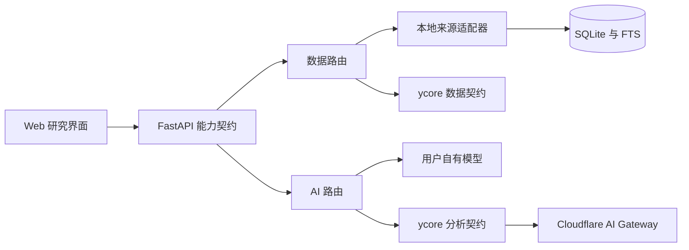

# 系统架构

本轮重新定义。React/TypeScript Web 只调用 FastAPI 的 `/api/v1`。Python 实现数据适配、证据关系、排序、分析与后台任务。SQLite 保存主数据、FTS 全文索引、配置及任务状态。首版无需独立图数据库。

ycore 及 Gateway 节点是远程契约边界，不代表本仓库已经部署该服务。

## 四类能力
新闻与事件、证券资料与行情、产业关系查询、AI 分析共享响应元信息：来源、数据时间、接口版本、完整性和告警。客户端不依赖来源供应商的字段。适配器失败不能被包装成正常空结果。

数据与 AI 独立路由，覆盖 local/local、local/ycore、ycore/local、ycore/ycore。本地 AI 凭据与 ycore 凭据分离。不得把 ycore token 发往自有模型，也不得向浏览器返回供应商密钥。

## 数据处理
新闻保留原文引用和抓取时间。URL 归一、内容指纹和事件匹配依次处理重复；聚合只改变组织方式，不丢失原始来源。时间未知、纠错和新增事实保留独立状态。排序把事件重要性和个人相关性分开，再考虑时效与多样性。

证券按交易所同步。名称和上市状态有时间戳；当任一交易所获取不完整时，不据此推断退市。行情有独立报价时间，不拿证券资料同步时间当行情时间。

产业图使用 SQLite 节点、边及证据记录。分类边仅表示行业归属；供应关系须有披露证据，推断单独标识。导入校验引用、许可、来源和时间，失败事务回滚。查询提供行业层次、公司局部关系与事件路径，并返回缺口。

分析只使用当前证据快照。六类输出都保留引用，非法证据 ID 拒绝入库。新增证据使既有分析陈旧；同一快照的重复任务应幂等。无模型配置时仍可浏览事实与关系，不生成伪分析。

## 运行与恢复
服务启动初始化数据库和任务执行器。网络有超时，来源独立记录健康；任务有限重试，进程重启后恢复未完成任务。定时同步可配置。缓存数据保留来源时间和陈旧状态。

本地单用户是默认部署边界。对外服务部署须另加认证、TLS、访问控制和运营限额。托管 ycore 负责用户鉴权、权益、用量及任务，托管供应商和 Gateway 密钥仅留服务端。

## 扩展
付费源通过能力声明、限额、更新策略接入。Jev 等决策模型接入同一受限判断接口，经过中文样本评测再替换规则环节。未来原生客户端复用服务契约，不复用 Web 组件实现。
