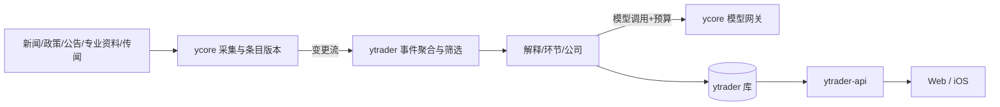

# 职责与技术方案

2026-10-15 架构基线，配合 [产品定义](PRODUCT.md)。ycore 与 ytrader 均未实现，下文是设计决策而非既成事实；数值均为可调默认值，未经测量。产品以每日重要变化的解释为主线，来源、iFinD 或已有图谱都不限定产品边界。

## 1. 进程、存储与职责

同一台约 2 核 4GB 新加坡机器，各服务独立容器；同机不等于同系统。

| 进程 | 归属 | 职责 | 内存预算(设计目标) |
| --- | --- | --- | --- |
| postgres | 共享实例 | 分库 `ycore`/`ytrader`，各自独立角色，无跨库授权 | 1GB（shared_buffers 256MB） |
| ycore-api | ycore | 来源条目、来源调用、模型调用、产品预算接口 | 384MB |
| ycore-worker | ycore | 采集调度、模型调用执行与用量结算 | 384MB |
| reuse-* | ycore 适配 | 复用的 Python 采集/解析组件，独立服务，只经 ycore 适配器调用，内部存储保留 | 合计 512MB |
| ytrader-api | ytrader | Node 产品 API、认证、读模型 | 384MB |
| ytrader-worker | ytrader | 业务任务：事件聚合、筛选、解释、公司分析、失效重算 | 512MB |

以上合计约3.2GiB，只是进程预算，当前主机实际约3.7GiB；系统、代理和突发还需空间，不能据此判定容量足够。Web（React/Vite）静态资源放 Cloudflare 托管；iOS 用 Capacitor 打包同一前端，属于待工程验证的首选。不引入 Redis、消息队列或图数据库。staging 默认在本机或可丢弃隔离环境运行；只有实测余量足够才放同机独立环境。关闭staging付费模型并缩小批次；不足时停止staging，不为其暂停或降级生产。生产调整需相应授权。

能力归属：ycore 负责来源连接、凭据、限流、中性条目及其不可变版本、条目变更流、模型网关和真实费用硬上限；ytrader 负责事件、筛选规则、重要性、证据状态、产业环节、公司关系、分析、用户状态、客户端 API 和业务调度。双方只通过 [契约](CONTRACTS.md) 的 HTTP 接口交互，不跨库读写。

## 2. 对象、状态和证据依赖

内部ID采用带类型前缀的ULID，证券身份采用`{market}.{code}`（SSE/SZSE/BSE）。已发布版本不可变；当前指针和状态投影可变，历史事实不被覆盖。

| 对象 | 必需含义与约束 |
| --- | --- |
| ItemRef | ycore条目ID+版本；保存许可允许的元数据，内容删除后引用成为墓碑，不填造原文 |
| Event / EventVersion | lifecycle=ongoing/ended/disproved；publication=unpublished/published/merged；合并指向唯一canonical事件。version单调递增，记录initial/substantive/minor/correction；已发布版本必有core_claim_ref={claim_id,version}，引用其自身断言集合，保持旧ID可解析 |
| Claim / ClaimVersion | type=fact/source_opinion/conditional_inference；evidence=primary/corroborated/unverified/conflicting/refuted；review=none/needs_review/reviewed独立于证据状态；引用具体ItemRef及支持位置 |
| Conclusion / Dependency | 环节/公司影响及条件、反向因素；状态active/withdrawn/superseded；依赖具体Claim版本，派生推断保留完整依赖以便传递失效 |
| ChainNode / Relation / CompanyMapping | 环节、关系、公司业务映射，均有出处、有效时间；概念候选不能直接升级为已确认业务关系 |
| EventCompanyExposure | 事件版本、company_id、有效CompanyMapping引用、mechanism_conclusion_ref、公司业务暴露Claim引用、连接两者的条件推断及其依赖；没有事件级连接不发布公司落点 |
| AnalysisReport | 公司ID、方法、版本、输入指纹与证据引用、模型/提示词版本、数据截止与生成时间；内容成功才发布；当前投影current/stale/withdrawn |
| Digest | snapshot_id/version、window_start/end（滚动24小时）、来源水位、最多10条主列表/3条观察、更多项分页；只引用事件版本，不复制成另一份有效性来源 |
| ReadState | 用户、canonical事件ID、last_read_version，单调MAX更新；实质变化与更正版本单独记录，文字小修不强制重读 |

事件发生、来源发布、首次发现、抓取、生成和有效起止时间分别记录，未知返回null，不相互回填。

**处理流程**：来源标准化及重复识别 → 提取有出处的断言 → 事件归并/实质变化识别 → 按产品规则分类筛选 → 补足机制/公司业务资料 → 输出有条件解释 → 校验引用和关键字段 → 原子发布。模型输出必须通过结构、引用存在性、数值/单位来源和关系来源检查；语义支持程度仍须通过预先冻结的真实样本验收，不能以引用存在就证明结论正确。外来正文只作数据，模型不执行其中的指令，也不拥有任意外部写工具。

**聚合规则**：先用原始文档号/规范URL识别转载线索，再按主体、动作类型、对象、地点和事项发生/生效时间建立候选事件指纹；日期不能单独作合并键。独立来源的这些要素一致且指向同一事项才自动归并，回应/辟谣按明确被回应断言关联。跨日进展沿用事件，独立新行动/重复发生另建关联事件；有歧义则不自动合并。归并后仅canonical事件占首页位置。合并/拆分发布新版本、保留别名与变更理由；不同事件的版本号不能直接取MAX迁移已读，读者实际打开canonical新版本后才标读。

**发布门**：core_claim_ref必须存在且与卡片摘要一致；主列表/观察区依据该断言证据状态和复核状态路由，不能挑事件中最强的另一条证据替它背书。公司成员映射只是候选，发布公司落点必须有EventCompanyExposure；宏观事件可以通过公司业务资料形成条件推断，不强求新闻原文直接点名公司。

**撤回与一致性**：条目新增版本触发复核；被否定或实质更正的断言沿依赖撤回受影响结论/报告，有独立依据的关系不连带删除。本地同一事务写新事件版本、撤回状态、更正记录、current指针和首页投影。任何API读取历史Digest也要叠加当前撤回标记；不能因重算失败继续展示错误结论。依赖仍有效的普通旧报告才可标stale读取。

**跨服务水位**：ytrader每5分钟读取ycore变更（默认值）；消费成功提交产品事务后才推进游标，重复消费幂等。超过时效或断联显示水位陈旧；不承诺跨服务零延迟。游标过期以固定水位快照恢复，同时核对所有已引用版本，重建完再接续变更，过程见契约。

更正元数据在许可允许范围保留；原文/摘录被要求删除时移除内容并保留允许的墓碑。离线端只能展示带最后核验时间的缓存，不能声称已获知离线期间的更正。

## 3. 调度、持久任务和重启

ycore独占来源采集与模型调用执行调度；ytrader独占业务聚合、筛选、解释和公司分析调度，各自只有一份任务事实来源。不是两边重复调度同一业务任务。

设计默认：来源轮询按各源许可与限额配置；首页批次北京时间07:30/12:30/20:30，周末同样运行；证据更正优先消费，不等下个首页批次。已有公司分析按24小时或输入变更刷新，受预算约束；浏览页面不触发模型。

任务字段：id、kind、input_fingerprint、idempotency_key、status(queued/running/succeeded/failed/blocked/outcome_unknown/cancelled)、step、attempt、run_after、lease_until、fencing_token、invocation_id。Postgres领取租约，默认5分钟租约/60秒续约。租约过期后新worker取得新fencing_token，旧worker不得提交；已记录invocation_id的步骤只查原调用，不重新创建。

业务幂等键包含对象、方法、有效输入版本和步骤；同一键绑定同一请求体，不同内容复用键返回409。结果事务按输入指纹去重，避免重启后重复版本和重复刷新额度。短期HTTP重复请求缓存可清理，但模型幂等/未决记录与业务唯一约束不因24小时过去失效。

模型请求前先持久化dispatched。明确未受理的失败才允许退避重试；已发出后超时、连接中断、无确定结果的5xx记unknown，不自动跨周期重发。对象显示待核实、同输入刷新返回pending_verification。供应方未提供幂等/结果查询时不能保证exactly-once；未知调用由运行负责人核对，预算占用不释放，不以“调用失败”猜测未计费。

## 4. 模型开关、预算和重试

现场核验与设计配置分开：已有Gemini服务和Google BYOK网关，但现有网关开启自动重试、未设成本限制，不能直接作为本设计已实现的证据。配置差异及隔离决策见[READINESS.md](READINESS.md)。

生产provider、产品凭据、费用授权与上界未核实时，ycore `enabled=false`、日/月上限为0；ytrader模型功能关闭。开发agent OAuth不作为产品服务授权。模型只支持固定白名单策略，客户端不能选择任意高价模型或发送任意提示词。

金额用统一币种最小单位整数记录。provider启用前必须核实输入、输出及附加费用的最大边界U和价格版本；不能界定上界的调用保持禁用。派发前原子检查`日spent+reserved+U≤日limit`、`月spent+reserved+U≤月limit`，再预留；自动与手动共享上限，手动保留日预算30%，自动最多70%，手动可用剩余自动份额。池比例是可调默认，不新增付费授权。

已知成功费用从reserved转spent并释放余量；unknown保持reserved，不重复计spent，也不因换日/月自动消失，跨期未决额继续扣减可用额度。若外部收费超过核实的上界，停止provider并报警，记录实际偏差；本系统准入预算不冒充外部账单绝对保证。无费用数据记unknown而非0。

手动技术额度：每公司/方法每小时1次、用户每日10次。相同活动任务复用不再扣次数；派发前确定失败可退还技术额度，已派发或未知不退。自动和手动均在真正派发时重新核对预算。

只对确定未被受理的暂时错误按1/5/20分钟最多3次退避，遵守retry_after。鉴权/策略/参数错误不重试；预算不足blocked并显示恢复条件；unknown不重发。连续失败5次熔断15分钟。运行负责人处理无法自动核实的例外，不引入每条分析的人工审批。

## 5. 单用户认证

采用成熟密码哈希/会话库，服务端Postgres会话；当前无已建立账号。首次以受控bootstrap建立强密码账号，密码不写Git、镜像、日志或前端。登录在应用和入口限速，错误响应不暴露账号细节；TOTP后续可选，不额外做设备管理界面。

Web使用HttpOnly/Secure/SameSite=Lax cookie，校验Origin，写操作用CSRF令牌；仅允许明确Web域名的凭据请求。iOS以原生请求携带不透明设备会话token，Keychain保存，服务端只存token摘要；不放localStorage或打包服务密钥。会话空闲7天/绝对30天是默认目标；退出立即撤销当前会话，改密码或运维CLI可撤销全部。

Capacitor Cookie/Bearer、Keychain、过期与退出的实际兼容性列入首次工程验证。CORS不是认证边界；Cloudflare Access可作外层，但不作为双端唯一认证依赖。端点都经TLS，ycore服务凭据仅在ytrader服务端，按产品隔离与轮换。

## 6. 容量、故障表现与可观测

**首期并发默认值：** 模型任务并发 1；采集并发 2；API 数据库连接池 10，worker 连接池 5；单次模型调用超时 120 秒；单个批次每页最多处理300个候选条目，通过持久游标继续处理积压，不以数量上限静默丢弃来源数据。积压年龄超过计划周期则报告延迟。

**故障时的产品表现：**
- 部分来源失败：首页显示覆盖缺口，例如“某来源最近一次成功于某时间”。
- 全部来源失败：首页状态为 unavailable，保留上一版并标为过期。`empty` 只表示“来源正常，但没有内容通过筛选”，两种状态不能混用。
- 模型失败或未开启：事件只显示从来源摘取的事实摘要，并注明“影响解释未生成”及原因。
- 分析失败：只保留依赖仍有效的历史结果并标旧；已否定的依赖导致报告withdrawn；从未成功过返回none或unavailable。

**日志：** JSON 格式。字段包括 ts、level、service、request_id、job_id、job_kind、step、attempt、idempotency_key、event_id、company_code、method、item_ref_count、provider、model、prompt_version、tokens_in、tokens_out、cost_reserved、cost_settled、outcome、error_code、latency_ms。日志里不能出现凭据、token 或正文全文。

**备份：** 两个库每晚各做一次 pg_dump，加密后存到机器之外（具体位置待定，见第 7 节），保留 7 份日备和 4 份周备。目标 RPO 24 小时，RTO 2 小时。首次验收前，必须在 staging 完成一次恢复演练，并核对版本/依赖/任务水位及一条实际阅读链路，行数相等不单独证明恢复成功。

**迁移：** 只向前迁移，按 expand→contract 两步进行；每次迁移前先做一次 dump。回退方式是部署上一版镜像，只适用于 expand 类迁移；破坏性的 contract 迁移至少隔一个版本才执行。

## 7. 依赖与放行边界

| 阶段 | 必须具备 | 责任/解除方式 |
| --- | --- | --- |
| 本地实现 | 用户开发授权、已对齐PRD/契约、可丢弃本地环境和明确fixture范围 | CEO确认授权和任务包；架构师固定契约，工程师实现。fixture只证明接口/状态，不证明真实产品 |
| 真实链路联调 | ycore最小实现；已核验的发现与补证来源；产品模型provider/凭据/预算 | CEO调查现有授权与能力，架构师验证接入及预算；只有无法取得的账号/新增费用才请用户处理 |
| 个股分析验收 | 经营基本面所需字段、日期、单位与可用权限 | CEO核实iFinD/原始披露，架构师验证数据；缺必需字段不能声称方法可用 |
| 双端产品验收 | 已签名iOS真机、认证/缓存/撤回正确，真实内容边界样本通过 | 架构师核对环境，工程师构建，Codex实测；需要设备/身份时向用户提具体缺项 |
| 对外运行 | 相应发布授权、TLS/身份、资源实测、机外加密备份与一次恢复、运行告警路径 | CEO选择并核实现有资源，架构师负责设计，Codex验证；不要求用户代做技术选型 |

所有真实依赖当前仍待验证。只读样本和文档不作为已实现接口、已授权模型或已稳定运行的证明。部署细节以本设计和 DEPLOYMENT.md 为准，冲突由架构师提出、CEO裁决，不能在代码中悄悄改变。
