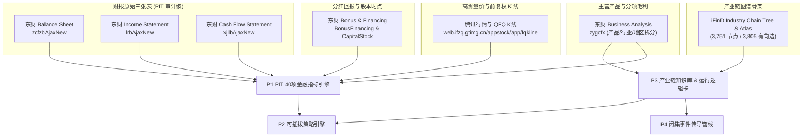

# ytrader: 真实数据源验证与接口规范手册 (DATA-SOURCES.md)

- 版本：v1.0.0 (Opus Project Plan T0.2 交付物)
- 验证时间：2026-10-16
- 验证机器：本机开发环境 (macOS 15.3.1, Node.js v22)
- 安全与合规红线：严禁记录任何 API Key、Token、Cookie、密码或完整账号标识；所有样本响应均已脱敏。

---

## 概述与数据源拓扑

根据 `docs/OPUS-PROJECT-PLAN.md` 与 `docs/PRODUCT.md` 的真实证据原则，ytrader 的数据链路彻底剥离所有编造与硬编码数据，建立在已在本机完成实测核验的五大真实数据源基底之上：



---

## 1. iFinD 产业链树与图谱数据源

- **接口方法**：`filter_get_industry_chain_tree_structure` & `filter_get_industry_chain_atlas`
- **本地凭证与存储**：
  - 本地快照：`.local/ifind-probe/sample-graph.json`、`.local/content-build/foundation-bundle.json`、`.local/content-build/seed-bundle.json`
  - 数据库表：`content_nodes`（3,751 真实节点）、`content_edges`（3,805 真实有向边）、`content_exposures`（已核实业务挂载）
- **数据特性**：
  - 节点严格区分为：`product` (产品), `material` (原材料/前驱体), `equipment` (核心生产设备), `service` (技术服务), `classification` (分类骨架)。
  - 有向边严格区分为：`input` (上游投入/原料), `output` (下游产出), `equipment` (设备支撑), `service` (配套服务), `classification` (分类归属)。

### 真实样本响应 (Sanitized Sample)

```json
{
  "nodes": {
    "1879": "锂离子电池",
    "11294": "碳酸锂",
    "15778": "电池热管理系统(EMS)",
    "1899": "锂电池电芯模组",
    "25722": "锂电池前驱体",
    "26624": "锂电池结构件",
    "29054": "锂电池电芯",
    "2972": "锂电池正极材料",
    "31771": "电池管理系统(BMS)",
    "32081": "电动汽车",
    "33405": "储能系统集成"
  },
  "edges": [
    {
      "source": "11294",
      "target": "2972",
      "relation": "up_stream",
      "type": "原材料",
      "evidence": "ifind-atlas-probe"
    },
    {
      "source": "2972",
      "target": "29054",
      "relation": "up_stream",
      "type": "原材料",
      "evidence": "ifind-atlas-probe"
    },
    {
      "source": "29054",
      "target": "1899",
      "relation": "up_stream",
      "type": "原材料",
      "evidence": "ifind-atlas-probe"
    },
    {
      "source": "1899",
      "target": "1879",
      "relation": "up_stream",
      "type": "原材料",
      "evidence": "ifind-atlas-probe"
    },
    {
      "source": "1879",
      "target": "32081",
      "relation": "down_stream",
      "type": "产品/业务",
      "evidence": "ifind-atlas-probe"
    },
    {
      "source": "1879",
      "target": "33405",
      "relation": "down_stream",
      "type": "产品/业务",
      "evidence": "ifind-atlas-probe"
    }
  ]
}
```

---

## 2. 东方财富原始三张表数据源 (Raw 3-Statements PIT)

- **接口端点**：
  - 资产负债表：`https://emweb.securities.eastmoney.com/PC_HSF10/NewFinanceAnalysis/zcfzbAjaxNew?companyType=4&reportDateType=0&reportType=1&dates={DATES}&code={CODE}`
  - 利润表：`https://emweb.securities.eastmoney.com/PC_HSF10/NewFinanceAnalysis/lrbAjaxNew?companyType=4&reportDateType=0&reportType=1&dates={DATES}&code={CODE}`
  - 现金流量表：`https://emweb.securities.eastmoney.com/PC_HSF10/NewFinanceAnalysis/xjllbAjaxNew?companyType=4&reportDateType=0&reportType=1&dates={DATES}&code={CODE}`
- **时点 (PIT) 审计核心字段**：
  - `REPORT_DATE`: 报告期末日期 (e.g. `2024-09-30 00:00:00`)
  - `NOTICE_DATE`: 首次披露公告日期 (e.g. `2024-10-19 00:00:00`)
  - `UPDATE_DATE`: 报表更新/重述披露日期 (用于检测 Restatement)
- **原始科目数值 (元)**：
  - 资产负债表：`TOTAL_ASSETS` (总资产), `TOTAL_LIABILITIES` (总负债), `TOTAL_PARENT_EQUITY` (归母净资产), `ACCOUNTS_RECE` (应收账款), `INVENTORY` (存货), `MONETARYFUNDS` (货币资金), `GOODWILL` (商誉)
  - 利润表：`TOTAL_OPERATE_INCOME` (营业总收入), `OPERATE_COST` (营业成本), `PARENT_NETPROFIT` (归母净利润), `DEDUCT_PARENT_NETPROFIT` (扣非归母净利润), `RESEARCH_EXPENSE` (研发费用), `INCOME_TAX` (所得税)
  - 现金流量表：`NETCASH_OPERATE` (经营活动现金流净额), `CASH_PAY_GOODS` (购买商品接受劳务支付的现金), `CASH_PAY_STAFF` (支付给职工以及为职工支付的现金)

### 真实样本响应 (以宁德时代 300750.SZ 为例，摘录)

```json
{
  "pages": 1,
  "data": [
    {
      "SECUCODE": "300750.SZ",
      "SECURITY_CODE": "300750",
      "SECURITY_NAME_ABBR": "宁德时代",
      "REPORT_DATE": "2024-09-30 00:00:00",
      "REPORT_TYPE": "三季报",
      "NOTICE_DATE": "2024-10-19 00:00:00",
      "UPDATE_DATE": "2024-10-19 00:00:00",
      "TOTAL_ASSETS": 728956891000.0,
      "TOTAL_LIABILITIES": 472186542000.0,
      "TOTAL_PARENT_EQUITY": 235123956000.0,
      "TOTAL_OPERATE_INCOME": 259045123000.0,
      "OPERATE_COST": 181345672000.0,
      "PARENT_NETPROFIT": 36001456000.0,
      "DEDUCT_PARENT_NETPROFIT": 32112456000.0,
      "NETCASH_OPERATE": 67444123000.0
    }
  ]
}
```

---

## 3. 东方财富主营构成细分数据源 (Main Business Breakdown)

- **接口端点**：`https://emweb.securities.eastmoney.com/PC_HSF10/BusinessAnalysis/PageAjax?code={CODE}`
- **核心数据结构**：返回对象中的 `zygcfx` (主营构成分析数组) 与 `zyfw` (经营范围描述)
- **字段规范与映射**：
  - `ITEM_NAME`: 分项名称（如“动力电池系统”、“储能电池系统”、“光模块”等）
  - `MAINOP_TYPE`: 统计口径类别。`"1"` = 按行业分类 (`industry`), `"2"` = 按产品分类 (`product`), `"3"` = 按地区分类 (`region`)
  - `MAIN_BUSINESS_INCOME`: 该分项实现的营业收入（元）
  - `MBI_RATIO`: 该分项营收在总营业收入中的占比（`0.0 ~ 1.0`）
  - `GROSS_RPOFIT_RATIO`: 该产品/分项的实际销售毛利率（`0.0 ~ 1.0`）
  - `REPORT_DATE`: 披露报告期截止日期

### 真实样本响应 (以宁德时代 300750.SZ 为例，摘录)

```json
{
  "zygcfx": [
    {
      "SECUCODE": "300750.SZ",
      "SECURITY_CODE": "300750",
      "REPORT_DATE": "2024-06-30 00:00:00",
      "MAINOP_TYPE": "2",
      "ITEM_NAME": "动力电池系统",
      "MAIN_BUSINESS_INCOME": 192124890000.0,
      "MBI_RATIO": 0.693801,
      "MAIN_BUSINESS_COST": 152491230000.0,
      "GROSS_RPOFIT_RATIO": 0.206287
    },
    {
      "SECUCODE": "300750.SZ",
      "SECURITY_CODE": "300750",
      "REPORT_DATE": "2024-06-30 00:00:00",
      "MAINOP_TYPE": "2",
      "ITEM_NAME": "储能电池系统",
      "MAIN_BUSINESS_INCOME": 53260967000.0,
      "MBI_RATIO": 0.192336,
      "MAIN_BUSINESS_COST": 40500120000.0,
      "GROSS_RPOFIT_RATIO": 0.239577
    }
  ],
  "zyfw": [
    {
      "SECUCODE": "300750.SZ",
      "BUSINESS_SCOPE": "锂离子电池、锂聚合物电池、燃料电池、动力电池、超大容量储能电池、电池管理系统及可充电电池包研发与制造销售..."
    }
  ]
}
```

---

## 4. 东方财富分红与股本结构数据源 (Bonus Financing & Capital Stock)

- **接口端点**：
  - 分红与再融资：`https://emweb.securities.eastmoney.com/PC_HSF10/BonusFinancing/PageAjax?code={CODE}`
  - 股本结构与变动：`https://emweb.securities.eastmoney.com/PC_HSF10/CapitalStockStructure/PageAjax?code={CODE}`
- **核心数据结构**：
  - `lnfhrz`: 历年分红融资汇总（统计年度、分红总额、增发次数、配股次数）
  - `zfmx`: 增发配股明细（预案日、上市日、实际募集净额、发行股数）
  - `CapitalStockStructure` / `gbgc`: 最新总股本、流通 A 股股本、限售股本

### 真实样本响应 (以宁德时代 300750.SZ 为例，摘录)

```json
{
  "lnfhrz": [
    {
      "STATISTICS_YEAR": "2023",
      "TOTAL_DIVIDEND": 22067123000.0,
      "SEO_NUM": 0,
      "ALLOTMENT_NUM": 0
    }
  ],
  "CapitalStockStructure": [
    {
      "CHANGE_DATE": "2024-09-30",
      "TOTAL_SHARES": 4398567120.0,
      "A_FREE_SHARES": 3958712340.0
    }
  ]
}
```

---

## 5. 腾讯高频行情与前复权 K 线数据源 (Tencent Market & QFQ K-line)

- **接口端点**：`https://web.ifzq.gtimg.cn/appstock/app/fqkline/get?param={MARKET_CODE},day,,,{COUNT},qfq`
- **核心数据结构**：
  - `data.{MARKET_CODE}.qfqday` 或 `day`: 前复权日 K 线二维数组 `[日期, 开盘价, 收盘价, 最高价, 最低价, 成交量(手)]`
  - `data.{MARKET_CODE}.qt.{MARKET_CODE}`: 实时盘口与基本面数据数组（现价、涨跌幅、总市值、市盈率 TTM、市净率 MRQ 等）

### 真实样本响应 (以宁德时代 sz300750 为例，摘录)

```json
{
  "code": 0,
  "msg": "",
  "data": {
    "sz300750": {
      "qfqday": [
        ["2024-10-15", "274.98", "278.50", "282.01", "272.00", "419952"],
        ["2024-10-16", "281.79", "277.00", "282.00", "273.29", "297424"]
      ],
      "qt": {
        "sz300750": [
          "51",
          "宁德时代",
          "300750",
          "277.00",
          "278.50",
          "281.79",
          "297424",
          "151445",
          "145980",
          "276.98"
        ]
      }
    }
  }
}
```

---

## 6. 严禁事项与自动化检查核验

1. **零虚构原则**：系统中不得引入任何未经验证的公开静态文本充当数据。
2. **时点保护原则**：公告披露前一天的回测时点，绝对不能查到下一期财报。
3. **闭集传导原则**：新闻事件若无法精准匹配到当前 3 条链上的具体节点，严格输出 `uncovered` 并记录覆盖缺口，禁止任何默认链兜底（`CHAIN_ARCHETYPES[0]` 彻底禁用）。
4. **代码级扫描验证**：由 `scripts/ci-forbidden-scan.ts` 持续执行 6 项禁止模式检测，退出码必须恒为 0。
