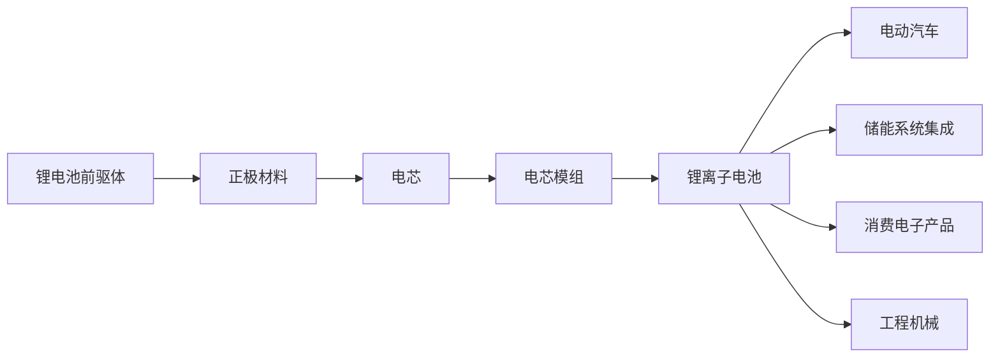

# iFinD 账号实查：锂电池产业链

2026-10-15，通过用户已登录的 [iFinD MCP 调试页](https://mcp.51ifind.com/#/profile)完成 12 次请求。使用现有试用账号，未新增订阅、复制密钥或修改账号配置。本次验证数据可得性，不代表产品已实现。

## 结论

**iFinD 可以直接提供产业链节点和上下游结构，适合作为首版骨架。** 关键接口位于同账号的“企业数据／快查”，金融数据工具列表不足以覆盖这项能力。

目前缺口是：节点到企业的专用接口本次返回服务端 404；图谱样本没有逐条关系的依据与更新时间；简明利好利空及原因需要结合事件和资料整理。可先用主营业务核对少量公司映射，并用原始披露补充缺失关系，无需另建复杂图推理系统。

数据来源于同花顺旗下快查企业数据引擎；公司业务、证券筛选、指标与资讯来自 iFinD 金融数据工具。

## 实际拿到了什么

| 内容 | 实查结果 | 使用边界 |
| --- | --- | --- |
| 节点目录 | `filter_get_industry_chain_tree_structure` 成功。返回节点代码、名称、层级与子节点；目录中可定位锂离子电池 `1879`、电芯 `29054`、正极材料 `2972`、碳酸锂 `11294` 等。 | 树的父子分类与生产上下游是不同关系；目录中同一代码可能出现在不同位置。 |
| 上下游图谱 | `filter_get_industry_chain_atlas` 对锂离子电池、电芯、正极材料均成功。返回 `up_stream`、`down_stream`、`contains_stream` 等结构，区分原材料、设备、服务、产品。 | 样本中的替代、互补数组为空，不能据此认为整个产业没有此类关系；保留供应方分类，但不将其视为完整覆盖。 |
| 节点关联企业 | `filter_get_industry_chain_enterprise_list` 已发现，带上市筛选和分页参数；对 `1879` 的查询返回下游服务路径 `/industry_chain_api/ic/pro_chain/enter_list_cust` 的 404。 | 是本次服务调用失败；不能判定为账号没权限，也不能判定数据库不存在映射。无需为此先升级套餐。 |
| 公司业务 | `get_security_indicators` 成功返回天齐锂业、恩捷股份、宁德时代、比亚迪的代码、主营产品和业务。 | 同次请求的“产业链上游／下游”字段未返回；该工具不能替代上述图谱接口。 |
| 从环节找个股 | `search_securities` 的“主营产品包含锂电池隔膜”问法返回空；改为“锂电池隔膜概念股”返回 50 家候选及产品、相关系数、文字依据。 | 可作为候选发现。含材料供应方、使用方等，不能把所有命中公司都标成隔膜生产商；相关系数不能当业务占比或影响强度。 |
| 宏观指标 | `search_edb` 返回 20 个指标目录项，包括碳酸锂现货价、正负极／电解液／隔膜产量、新能源车产销量等，带来源、频率、单位、起止时间。 | 同时混入隔膜泵和光伏电池片，需筛选。此次未调用 `fetch_edb`，未验证数值或最新趋势。 |
| 新闻与公告 | 新闻返回 5 条带日期、URL 的片段；公告返回 3 条带标题和日期的摘要式内容，没有原文 URL。 | 来源观点与原始披露应分开。命中结果不一定回答查询问题，关键结论须能追到原文。 |

## 一条已经验证的链

下图的每条箭头均来自本次三个图谱响应。展示的是产业环节，不代表具体公司之间已存在供货合同。

原始图谱还包括 BMS、热管理系统、PACK 设备与服务，以及不同电池类别。用户主视图可以收敛成“材料—电池—应用”，让更细的节点服务于解释，不把整份接口目录铺到页面上。

公司业务查询得到的代表性关联：

| 环节 | 公司 | 本次返回的业务依据 |
| --- | --- | --- |
| 锂资源／锂盐 | 天齐锂业 `002466.SZ` | 锂精矿及锂化工产品；产品包含碳酸锂、氢氧化锂等。 |
| 隔膜 | 恩捷股份 `002812.SZ` | 主营产品包含锂电池隔离膜；同时有包装等业务。 |
| 电池 | 宁德时代 `300750.SZ` | 动力电池系统、储能电池系统等；另涉及材料、回收及矿产。 |
| 整车／电池 | 比亚迪 `002594.SZ` | 汽车及新能源汽车、二次充电电池等；同时有电子业务。 |

以上是根据主营业务做的环节归类，不是失败的企业映射接口返回值，也不是一条公司供货链。星源材质 `300568.SZ` 还出现在隔膜候选筛选结果中，后续可按同样方式核对主营业务。

## 需要补什么，怎样补

1. **公司映射**：优先保留快查节点代码；专用接口恢复前，以证券筛选发现候选，再用主营产品／公告核对。先维护样本产业链，不用概念标签直接替代业务归属。
2. **少量缺失关系与出处**：本次电芯材料树的直接子类有正极、负极、电解液、集电器，未列出隔膜；已查的上游图也未直接连到碳酸锂。可以从原始报告补充并标注“整理补充”，不能据此推断其他节点接口也没有这些关系。[宁德时代 2024 年年报](https://www.catl.com/uploads/1/file/public/202503/20250317094543_6ig9e0mwng.pdf)披露的主要原材料包括正极、负极、隔膜和电解液，可作补充依据。
3. **结论和原因**：在关系骨架上，将具体事件整理成“发生什么—影响哪些环节／公司—大致方向—原因与主要条件”。这是当前产品的核心输出，不能用一张静态关系图代替。
4. **来源核对**：本次公告返回把 2024 年分红总额写为约 **1997.57 亿元**，公司原报告第 3 页为 **19,975,746,623.17 元，约 199.76 亿元**。因此摘要只能帮助定位资料；涉及结论的关键数字、关系和原因应核对原始出处。

示例表达（条件性推断，不是在断言当前锂价方向）：**如果碳酸锂价格下降，锂盐销售端可能承压，电池和整车环节可能获得成本改善；利润受益程度还取决于产品调价、库存和竞争。** 页面应先呈现这类结论及依据，微观指标用于支持分析；不把它自动翻译为个股涨跌或买卖信号。

## 验证边界与证据

- 共 12 次真实请求：6 次金融数据查询，1 次快查接口发现，1 次节点树，3 次图谱，1 次企业列表。企业列表失败，1 次证券筛选为空；没有对同一个 404 盲目重试。
- 仅验证一个主题的有限节点；未验证全市场覆盖、持续更新、批量性能、真实交易或产品界面。此次停止点是厘清数据骨架、公司映射路径和补充方式。
- 完整请求清单、未改写响应与本地核对记录位于项目忽略目录 `.local/ifind-probe/`。该目录没有账号密钥；不将账号返回的完整数据集发布到仓库。

## 补充：热门事件发现（同日）

在前述 12 次请求之后，另执行 **1 次** `search_trending_news`：`size=5`、`time_scope=24小时`、`sensitive=全部`，行业与关键词为空。官方调试页说明该工具面向近期高热度事件，不覆盖低热度/旧资讯，单次最多 20 条；空行业表示全行业。

响应成功，包含 5 条资讯和 1 条备注。资讯有标题、内容、URL、信息来源、热度；其中 1 条内容为空，未提供独立发布时间字段，两条内容属于同一事件的不同进展。备注说明热度只用于相对参考，没有实际业务含义。没有将这些报道内容或金额作为已核实新闻事实采纳。

产品含义：可以作为全市场事件发现入口，但需要与主题检索、公告核验组合；必须剔除备注、合并事件、核对原文时间，不用热度代替重要性。一次成功不能证明完整覆盖或稳定时效。

账号用量页在此请求前显示试用包 26 / 2000 已用；该数包含本任务以外调用，页面未显示刷新周期及到期日。本轮没有新增订阅或修改账号配置。响应保留于忽略目录 `.local/ifind-probe/trending-response.txt`，请求及检查记录见 `.local/product-definition/trending-observation.json`。
