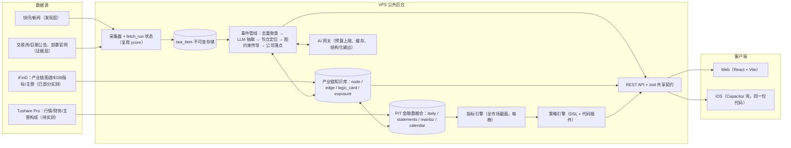
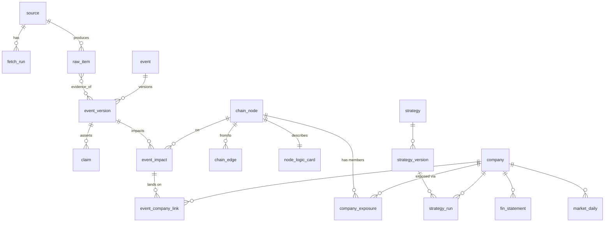
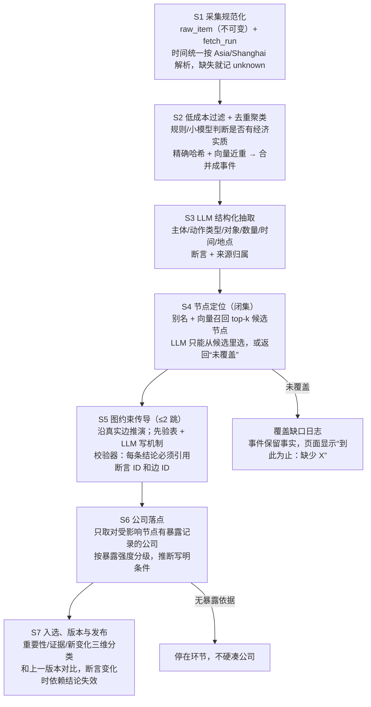
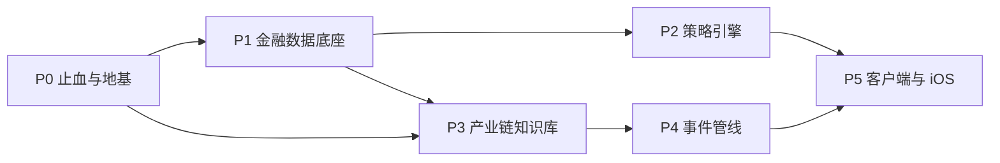

# ytrader：Opus 独立评审与项目开发计划

- 作者：Claude Opus 5.5（独立评审 / 首席规划）
- 日期：2026-10-16
- 评审对象：`server/content/{live-news,chain,indicators,strategies,strategy-chain-api}.ts`、`src/workbench/WorkbenchApp.tsx`，对照 `docs/PRODUCT.md`、`docs/IFIND-VALIDATION.md`、`docs/CHECKPOINT.md`
- 评审方式：只做了静态阅读，没有运行服务，也没有跑测试。下文“必然崩溃/必然为空”的结论，都是对照前后端代码的数据结构得出的，可以按文中行号自行核对。
- 本文不继承旧版项目任何结论；PRODUCT.md 中的证据原则（来源可追溯、证据不足就停）继续有效。

---

# 第一部分：Opus 评审——当前产品能用吗？

## 结论

**不能用，而且不是“有几个 bug”的程度。** 产品的核心价值链是：读懂事件 → 定位到产业链节点 → 推出传导机制 → 找到有业务暴露证据的公司 → 再做个股分析。这条链上每一环要么是写死的，要么是关键词正则配模板填空，要么是伪造的。界面看起来像“机构级投研终端”，但打开后要么拿不到数据，要么一点产业链按钮就崩，要么对每条新闻都套同样的三步模板、推同一批龙头股。

问题分五类，按严重程度排列。

---

## A. 前后端契约断裂：打开就是空白，点一下就崩

| # | 问题 | 证据 | 后果 |
|---|---|---|---|
| A1 | 新闻接口返回 `{ total, sources_status, items }`，前端却按数组判断 `Array.isArray(data)` | `live-news.ts` L324-362 ↔ `WorkbenchApp.tsx` L318-319 | **新闻流永远为空**，也不会自动选中事件 |
| A2 | 产业链列表接口返回 `{ chains: [...] }`，前端同样按数组判断 | `chain.ts` L820-841 ↔ `WorkbenchApp.tsx` L284-285 | 初始化时产业链加载不进来 |
| A3 | 前端写死的链 ID 是 `chain_semi / chain_ai_opt / chain_battery…`，后端 ID 是 `semiconductor / optical_ai / lithium_battery…` | `WorkbenchApp.tsx` L740-746 ↔ `chain.ts` L167/278/388 | `findArchetype` 一个都匹配不上，落到 `return CHAIN_ARCHETYPES[0]`（`chain.ts` L858）。**6 个按钮全部返回“半导体”** |
| A4 | 后端返回的是 `EventChainView`（`stages: ChainStageNode[]`、`running_logic`），前端却读 `currentChain.upstream.name`、`currentChain.profit_pool`、`currentChain.high_frequency_metrics.map(...)` | `chain.ts` L861-957 ↔ `WorkbenchApp.tsx` L767、L795、L821、L900 | 点任意链按钮都会走到 `undefined.map` → **React 整棵树崩溃，白屏** |
| A5 | 前端要读 `source_label` 和 `transmission.steps`，后端从来不产出这两个字段 | `WorkbenchApp.tsx` L12、L23、L704、L817 ↔ `live-news.ts` L3-18 | 来源标签为空；“事件传导推演”区永远显示前端写死的三步模板（L817-850），和选中的事件无关 |
| A6 | `/events/analyze` 返回 `EventChainView`，前端把它当 `LiveNewsItem` 塞进新闻列表 | `strategy-chain-api.ts` L79-96 ↔ `WorkbenchApp.tsx` L394-399 | 自定义推演的结果字段对不上，卡片残缺 |

`CHECKPOINT.md` 写着“全链路本地开发与端到端联调完成”“实测指标完备度 38~40/40”。**这个声明和上面的代码事实互相矛盾**，属于没有验证过的完成声明。

---

## B. 伪造与假状态：直接触犯 PRODUCT.md 的“关键错误即不通过”

1. **8 条编造的“精选基线事件”**（`live-news.ts` L21-172）：“北方华创并购诺合键维”“北美云厂商追加 1.6T 采购”等，没有来源、没有 URL，`source: 'curated_baseline'`。
2. **伪造发生时间**：这些假新闻的 `publish_time: new Date(Date.now() - 15*60*1000)`，每次请求都被刷新成“15 分钟前刚发生”，再和真实新闻混在一起按时间排序（L342-356），所以永远排在最前面。PRODUCT §6 把“编造来源/数字/时间”列为关键错误，这里两条全中。
3. **缺失时间就用当前时间冒充**：`raw.create_time ? ... : new Date().toISOString()`（L273、L313）。另外新浪的 `create_time` 是不带时区的北京时间字符串，VPS 时区是 UTC 时会**整体偏 8 小时**。
4. **失败和“无新增”无法区分**：抓取全部 `catch { return [] }`，`sources_status` 用 `length > 0` 判断。来源挂了以后，8 条假新闻照样把页面填满，用户看不出采集已经失败。直接违反 R4。
5. **ID 用 `Math.random()` 生成**（L269、L309）：同一条新闻每刷新一次 ID 都不同，已读、去重、版本、更正这些功能从根上就做不了。
6. **去重只比较标题前 20 个字**（L349）：“财联社10月16日电…”这类前缀相同的不同新闻会被误合并，同一事件在不同来源的标题又合并不上。
7. **数据源健康状态是写死的**：`/datasources/status` 直接返回 `status: 'online'`、`latency_ms: 180`、`status: 'healthy'`，一次探测都没做（`strategy-chain-api.ts` L110-161）。其中“PIT 时点审计引擎”的 endpoint 是 `local_in_memory_pit_gate`，**这个组件根本不存在**。
8. **顶栏徽章也是写死的**：“东财F10 + 腾讯行情 已连接”“四层PIT防未来函数: 启用”（`WorkbenchApp.tsx` L596-604），无论后端死活都显示绿灯。
9. **“NLP 产业链映射”是虚假标签**（`WorkbenchApp.tsx` L634）：全程没有调用任何模型，只有正则。
10. **40 项指标字典前后端各写一份**（`WorkbenchApp.tsx` L138-190 和 `indicators.ts` 中的 `INDICATOR_DEFINITIONS`），而且“主营业务项数”被归到了“量价波动风险”类。

---

## C. 产业链与事件传导：本质是“关键词 + 模板填空”，不是推理

1. **只有 6 条写死的产业链，共 650 多行静态文案**（`chain.ts` L164-817）。毛利率区间、“出口大变压器排产已至 2026-2027 年”“成熟制程国产化率超 50%”这类有时效性的断言，全都没有来源、没有日期。宇宙里只有 6 条链，A 股的大量事件（消费、地产、金融、有色、煤炭、化工、农业、军工、航运、汽车整车……）根本没有对应位置。
2. **匹配不上就默认归到半导体**（`chain.ts` L858；`analyzeCustomEventToChain` 中 `bestScore` 初值 -1，全部 0 分时第一条胜出，L971-984）。所以“央行降准”“猪价上涨”“某白酒提价”都会被映射到“半导体设备与先进封装”，并推荐北方华创。**这是最致命的一点：产品会很自信地输出错误的传导结论。**
3. **匹配有顺序偏见**：`findArchetype` 按数组顺序取第一个命中关键词的链（L853-857）。半导体排第一，并且含关键词“芯片”。于是“200G EML **光芯片**供给紧张”这条本该进光模块链的新闻，会被判进半导体链。
4. **方向判断靠正则抢先匹配**（`live-news.ts` L204-211、`chain.ts` L1004-1011）：负面词 `降|跌|风险` 排在正面词前面，所以“降本增效”“跌幅收窄”“降息”都会被判为利空；什么都没匹配上时默认 `positive`。另外完全没有“对谁利好”的概念：“美国对华芯片制裁”被判成利空，但它对国产替代链条可能是利好。
5. **“震中”环节也是正则判定**：文本里只要出现“锂”“设备”“芯片”等字样，就判为上游（`live-news.ts` L215）。几乎所有锂电新闻都含“锂”，所以永远被判为上游。
6. **传导步骤就是三套固定模板**（`chain.ts` L1030-1141），按震中在哪个环节选一套，只把 `input.title` 拼进字符串。“验证指标”按下标取 `high_freq_indicators[0..2]`，和事件无关；“条件/反证”取的是链级别的静态文案。
7. **公司落点 = 该环节写死的 3-4 只龙头**：同一环节的所有事件推的都是同一批股票，却全部硬标 `status: 'business'`（有业务依据），`event_impact` 还写成“直接影响公司在手订单与产品盈利”（`chain.ts` L1167-1176）。这违反了 PRODUCT §5“产业成员名单只产生候选，必须同时具备事件机制依据和公司暴露依据”的规定，并且编造了影响结论。
8. **三段式本身就是错误建模**：真实产业链是一张多分支、会跨链的有向图。比如光模块：DSP/光芯片/PCB/结构件 → 模块 → 交换机/服务器 → 云厂商；铜同时连着电网和算力。固定的上/中/下三列装不下“同一事件对同一层级的不同环节方向相反”这种最常见的情形。
9. **放着已经验证可用的真实骨架不用**：`IFIND-VALIDATION.md` 已经实测，iFinD 的 `filter_get_industry_chain_tree_structure` 和 `filter_get_industry_chain_atlas` 能返回节点和上下游结构，区分原材料、设备、服务、产品。代码完全没用，改成了手写。
10. **没有“事件”这个实体**：一条新闻就算一个事件，没有聚类、合并、版本、断言和证据状态。PRODUCT §2 的事件同一性、核心断言、证据状态，在代码里一项都没有落地。

---

## D. 个股指标与策略：数据源脆弱，口径错误，策略方法论用错

### D1. 数据源
- 全部依赖未授权、无 SLA 的网页私有接口：`emweb.securities.eastmoney.com` F10、`web.ifzq.gtimg.cn`、`zhibo.sina.com.cn`、`newsapi.eastmoney.com`。
- 腾讯行情按数组下标取字段：`qt[39]` 当 PE、`qt[45]` 当总市值、`qt[46]` 当 PB（`indicators.ts` L231-235）。接口字段顺序一变，就会**静默返回错误数值**，不会报错。
- 唯一的“正规”数据通路（iFinD）在指标代码里没有被使用。

### D2. 缓存没有过期
- `ready_count >= 10` 就永久返回旧快照（`indicators.ts` L157-160），没有 TTL，也没有交易日判断。行情、市值、波动率会永远停留在第一次抓取的那一天。违反 PRODUCT §5“超过 24 小时提示可能过时”。

### D3. 计算口径错误（会算出错误数字）
| 指标 | 问题 | 位置 |
|---|---|---|
| 扣非 E/P | 用腾讯的 PE(TTM) 倒数，乘以“最新报告期**累计**扣非/归母”的比例，TTM 和年内累计（YTD）口径混用 | L362-366 |
| 经营现金流总额 | 报告期**每股**经营现金流 × **当前**总股本。送转、增发之后股本时点就错位了 | L622、L769、L792 |
| 总资产 | 用“归母净利润 ÷ ROA”反推。东财的 ROA 是“净利润 ÷ 平均总资产”，分子分母口径都对不上，反推出的总资产是错的。GP/A、Sloan 应计都建立在这个错误分母上 | L514-515、L795-796 |
| GP/A | YTD 毛利 ÷ 总资产，没有年化。Q1 的数值天然只有年报的 1/4 左右，用固定的 20% 阈值去判，结论随季度漂移 | L511-522 |
| 小市值“壳污染” | 用绝对值 35 亿代替“全市场后 30% 分位”。系统里根本没有全市场截面数据，分位也就无从算起 | L431 |
| PIT 时点 | `usable_trade_date` = 公告日 +1 并跳过周末，不处理法定节假日；`restatement_datetime` 恒为 null；行情数据却被标成“四层 PIT” | L119-128、L279 |
| ST 判断 | 用简称正则判断，没有 ST 历史记录（何时戴帽、何时摘帽） | L414 |

### D4. 策略方法论用错
- 研究报告里的价值、质量、低波、动量，本质上都是**截面排序因子**（看个股在全市场或行业内的相对分位）。代码却对单只股票用绝对阈值判断（E/P>8%、GP/A≥20%、波动率≤26%），而且没有行业中性化。结果是银行永远“便宜”、科技股永远“昂贵”、轻资产公司 GP/A 永远“强”。
- **“产业链扩散”策略徒有其名**：只要主营产品数 > 0 就判为 `favorable`（`strategies.ts` L858），挂着 Cohen-Frazzini (2008) 的论文名，却和产业链、事件毫无关系。
- “可插拔”只是一个开关：6 个内置策略在 `switch` 里写死（L1003-1025）。自定义 DSL 只支持阈值 AND，没有 OR/NOT、分位、行业相对值、时间序列比较、缺失值策略；UI 的警示条件永远传空数组（`WorkbenchApp.tsx` L488）。
- 策略结果既不持久化，也不记录输入快照和版本，没法复查“上周为什么判成便宜”。

### D5. 个股与产业链完全脱节
- 个股策略不读取任何事件和产业链信息；产业链上展示的股票也不读取任何指标。两条线互不相识，用户要的“事件 → 产业链 → 个股”在数据层就没有接上。

---

## E. 产品形态偏离用户目标

- 用户要的是：**看懂产业链怎么运行、事件怎么传导、最后落到哪些个股**。现在做成了一个三栏仪表盘，满屏 emoji 标题和营销话术（“全景穿透”“绝对龙头”“遥遥领先”），信息密度高，可信度却是零。
- 设置了“自定义推演框”让用户自己粘贴新闻，和 PRODUCT R1“零选择阅读”相反。
- 桌面端固定 380px 三栏布局，没有考虑 iOS 端。

## 可以保留的东西

- Postgres、Fastify、auth、迁移脚手架，以及 Capacitor iOS 工程壳。
- zod 校验的写法、荐股禁词表（`FORBIDDEN_WORDS`）、PIT 四字段这个**设计理念**（实现要重写）。
- 各指标的公式说明，以及 F-Score 9 个分项的定义，可作为指标注册表的初稿。
- `IFIND-VALIDATION.md` 的实测结论（产业链骨架可以从 iFinD 获取）。
- ycore 的采集与 AI 预算网关边界（见 CHECKPOINT 中的契约）。

---

# 第二部分：Opus 项目开发计划

## 1. 产品重新定义（对齐用户原话）

> “通过新闻事件关联到对应产业链；产业链有展示（结构、链条、逻辑），让我看懂运行逻辑和事件传导；然后对应到个股；有单独的、可追加删除的个股分析算法模块；先把数据指标和数据源做好。”

由此只定义四个对象、五个页面：

| 对象 | 含义 | 关键约束 |
|---|---|---|
| **事件 Event** | 由多条来源聚合成的“同一件事”，带版本和断言 | 时间必须真实；断言要分别标注证据状态 |
| **产业链图 Chain Graph** | 节点（产品/材料/设备/服务）+ 有类型的边，每个节点附“运行逻辑卡” | 骨架来自 iFinD 等权威数据，每条边都有依据和日期 |
| **公司 Company** | 以“市场 + 代码”确定身份；按主营构成挂到节点上 | 公司挂在节点上必须有暴露依据（收入占比、披露原文） |
| **策略 Strategy** | 可追加、删除的分析模块，输入是 PIT 指标 | 输出档位和理由，不输出买卖建议 |

| 页面 | 用户得到什么 |
|---|---|
| 今日 | 24 小时内值得看的事件，带一句话影响、证据状态和真实来源状态 |
| 事件页 | 事实 → 震中节点 → 沿图传导（每一跳给方向、机制、条件、反向因素）→ 有暴露依据的公司；证据断在哪里就停在哪里 |
| 产业链页 | 可浏览的分层有向图，点节点看运行逻辑卡（定价方式、成本结构、供需、核心指标走势、成员公司真实毛利） |
| 公司页 | 经营基本面 / 事件暴露 / 策略分析三个页签 |
| 策略管理 | 追加、删除、启停、查看版本 |

非目标沿用 PRODUCT.md：不做买卖建议、目标价、交易回测、推送、多用户、Android。

---

## 2. 总体架构



**技术选型（尽量不换栈，降低迁移成本）**
- 后端：TypeScript + Fastify + PostgreSQL（保留现有栈）；任务队列用 **pg-boss**（基于 Postgres，单台 VPS 就能跑，不引入 Redis）；向量检索用 **pgvector**，做节点别名和实体消歧。
- 采集：复用 ycore 的采集、不可变 ItemRef、来源状态和 AI 预算网关，ytrader 只负责事件以后的环节（与 CHECKPOINT 中的边界契约一致）。
- 模型：一律走 AI 网关，用 JSON Schema 结构化输出，按内容哈希缓存。**读取已有结果时零模型调用**。模型供应商通过配置切换，不写死。
- 前端：React + Vite，移动优先的响应式布局；产业链图用 **elkjs 分层布局 + React Flow 渲染**；手机端不硬塞整张图，改为“逐跳列表 + 局部子图”。
- iOS：沿用仓库里已有的 Capacitor 工程，共用一份前端代码，真机签名交付。
- 契约：所有接口的请求和响应 schema 都放在 `shared/contracts/*.ts`（zod），**前后端 import 同一份**，并配合同测试。A 类那种崩溃必须在 CI 阶段就被拦下。

---

## 3. 数据模型（核心表）



每张表的关键字段如下，其余字段由实现方补充。

- **source / fetch_run**：`fetch_run(status ∈ ok | empty | partial | failed, started_at, finished_at, item_count, error_class)`。首页状态条**只能从这张表推导**。
- **raw_item**：`content_hash`（唯一键，用于幂等）、`url`、`published_at`（带时区，可以为空）、`published_at_source ∈ source | parsed | unknown`、`fetched_at`。**发现时间和发布时间必须分开记录，严禁拿一个填另一个**。
- **event / event_version**：事件 ID 稳定（从首条来源的确定性哈希派生）。每个版本记录 `core_claim_id`、`importance ∈ 重大 | 关注 | 不入选` 及理由、`change_kind ∈ 新事件 | 实质更新 | 无实质变化`。
- **claim**：`text`、`kind ∈ 事实 | 来源观点 | 条件推断`、`evidence_status ∈ 原始依据支持 | 独立报道支持 | 未核实 | 冲突 | 已被否定`、`raw_item_refs[]`。
- **chain_node**：`type ∈ product | material | equipment | service`、`origin ∈ ifind | disclosure | llm_proposed`、`status ∈ verified | candidate`、`aliases[]`、`embedding`。
- **chain_edge**：`relation ∈ input | equipment | service | substitute | complement`、`evidence_ref`、`as_of`、`origin`。
- **node_logic_card**：定价方式（长协/现货/成本加成/招标）、关键投入及成本占比、需求驱动、供给约束、核心指标列表（关联 `edb_series_id`）。**文字段落必须带引用**；“利润池/毛利区间”**不准写文字，只能用成员公司最新财报的毛利率实时计算**。
- **company_exposure**：`company, node, basis ∈ mainbz_revenue | disclosure | ifind_main_product`、`revenue_share`、`period`、`strength ∈ 主营(>50%) | 重要(20-50%) | 次要(<20%) | 仅概念`。
- **event_impact**：`event_version, node, hop(0/1/2), via_edge, direction ∈ 偏正面 | 偏负面 | 不确定`、`mechanism`、`conditions[]`、`counterforces[]`、`verify_metric`（必须取自节点指标列表，取不到就写“缺”）、`depends_on_claims[]`。
- **event_company_link**：`status ∈ candidate | supported`，并记录推断文本以及它依赖的暴露记录和 impact。
- **金融数据（PIT）**：`security`、`trade_calendar`、`market_daily`（OHLCV + 复权因子）、`daily_basic`（PE/PB/市值/换手）、`fin_statement`（三张表原始行，带 `ann_date`、`f_ann_date`、`end_date`、`report_type`、`update_flag`，保留更正前后所有版本）、`mainbz`、`dividend`、`name_history`（ST 历史）、`industry_member`（申万分类）。
- **indicator_value**：`(ts_code, key, as_of_date) → value, inputs_hash`，每晚全市场计算一次。
- **strategy / strategy_version / strategy_run**：版本不可修改；每次运行记录 `inputs_hash`、`as_of`、结果 JSON；读取缓存时不重算。

---

## 4. 真实数据源方案

> 下表中的接口名和权限门槛，必须先经 **T0.2 实测**拿到样本响应后才能写进代码；未实测的一律标“待核验”。

| 数据域 | 主数据源 | 备选/补充 | 用途与边界 | 状态 |
|---|---|---|---|---|
| 快讯/新闻（发现层） | ycore 现有采集器（新浪 7×24、东财快讯等） | iFinD 资讯 | **只用于发现事件，不能单独当证据**；按来源记录使用条件 | ycore 已有，需对接 |
| 原始披露（证据层） | 巨潮资讯 / 上交所 / 深交所公告 | Tushare 公告类接口（待核验） | 公司事件的原始依据 | 待核验 |
| 政策原文 | 国务院、发改委、工信部、商务部、证监会、统计局官网 | — | 政策类事件的原始依据 | 待接入 |
| 产业链骨架 | **iFinD `industry_chain_tree_structure` / `industry_chain_atlas`** | 年报“行业情况/主营”章节，由 LLM 抽取后作为候选 | 节点和边的骨架 | **已实测可用**（IFIND-VALIDATION.md） |
| 节点 → 公司 | Tushare `fina_mainbz`（按产品/地区拆分的主营构成） | iFinD `get_security_indicators` 主营产品；iFinD 概念股（只作候选） | 暴露强度 = 收入占比 | `fina_mainbz` 待核验；iFinD 已实测 |
| 证券基础 | Tushare `stock_basic`、`trade_cal`、`namechange` | — | 证券身份、交易日历、ST 历史 | 待核验 |
| 行情/估值 | Tushare `daily`、`adj_factor`、`daily_basic`、`index_daily` | — | 波动、Beta、动量、PE/PB/市值 | 待核验 |
| 财务 | Tushare `income`、`balancesheet`、`cashflow`、`fina_indicator`、`forecast`、`express`、`fina_audit` | iFinD | 三张表原始数据，原生带 `ann_date`/`f_ann_date`，可以做真正的 PIT | 待核验 |
| 股东与资本 | Tushare `dividend`、`top10_holders`、`stk_holdernumber`、`share_float`、`stk_holdertrade`、`pledge_stat` | — | 股东回报、解禁、增减持、质押红旗 | 待核验 |
| 行业分类 | 申万行业（Tushare `index_classify` / `index_member_all`） | — | 截面分位的行业中性化 | 待核验 |
| 产业高频指标 | iFinD EDB（`search_edb` 已实测，`fetch_edb` 取值尚未验证） | 统计局、海关总署公开数据 | 节点卡上的核心指标走势 | 部分实测 |

**原则**
1. 每个数据源都封装成 `Provider` 适配器，统一接口为 `fetch(params) → { rows, fetched_at, provider, reliability }`；每次调用都写 `fetch_run`；失败时**抛出明确的错误类别**，禁止 `catch { return [] }`。
2. AKShare 这类网页爬取型来源只能作为开发期兜底，必须标注 `reliability: scraped`，并在 UI 上显示“非授权来源”。
3. 各接口的付费档位和授权，由用户或 CEO 决定（见第 11 节），代码不默认依赖任何未授权的付费能力。

---

## 5. 核心管线：事件 → 产业链 → 个股



**几条关键设计**
- **为什么不能直接让 LLM 自由推演**：大模型会编造上下游关系和公司关系。这里的做法是让 LLM 在**真实图和真实证据的约束下做选择、写机制**，结构本身不交给模型决定。
- **动作类型分类**（S3）：供给冲击 / 需求冲击 / 价格变动 / 政策监管 / 技术突破 / 订单合同 / 产能投放或退出 / 业绩披露 / 资本运作 / 事故停产 / 诉讼处罚 / 贸易与制裁。
- **传导方向先验表**（S5）：用“冲击类型 × 边类型 × 节点定价方式”给出默认方向。例如上游供给收缩时，对上游自身价格偏正面；对使用它的下游，若是成本加成定价则“不确定（看能否顺价）”，若是招标锁价则偏负面。LLM 可以推翻先验，但必须写出理由，校验器会记录每一次推翻。
- **校验器（硬规则）**：拒收没有引用 claim 或 edge 的 impact；拒收图里不存在的节点；拒收验证指标不在节点指标列表里却又没标“缺”的结果；拒收含荐股禁词的文本。被拒收的结果只记日志，不发布。
- **“对谁利好”**：方向标在节点上，不标在整个事件上。同一事件可以对 A 节点偏正面、对 B 节点偏负面，这是对 PRODUCT §3“按环节分别给方向”的落实。
- **成本控制**：S2 过滤掉大部分噪声，只有通过过滤的事件才进入 S3-S6；同一内容哈希不重复调用模型；单日预算到达上限后暂停新分析，已有结果照常可读。

---

## 6. 产业链知识库建设

1. **首批 3 条链**（默认：锂电与储能、AI 算力与光模块、半导体设备与材料；可由用户替换），先做深再做广。
2. **骨架导入**：从 iFinD atlas 导入节点和边，标 `origin: ifind`，保留原始响应引用。树形分类和生产上下游关系要分开存（IFIND-VALIDATION.md 已经指出两者不同）。
3. **补边**：LLM 从年报、招股书中抽取上下游关系，存为 `candidate` 并附原文片段。用户在一个轻量的“知识库校对页”里确认。这是一次性的建库工作，不属于日常使用路径，不违反 PRODUCT 关于“不把日常使用建立在人工审批上”的约定。
4. **节点运行逻辑卡**：LLM 起草，每句话都必须带引用；毛利、规模等数字**一律用成员公司的财报实时计算**；核心指标挂上 EDB 序列，页面展示真实走势和数据截止日期。
5. **公司挂载**：把 `fina_mainbz` 的产品名映射到节点（闭集映射：LLM 只能从该链的节点里选，或返回“无法映射”），计算收入占比和强度等级；iFinD 概念股只能作为候选。
6. **展示**：分层有向图（不是固定三列）。事件页只显示“震中 + 2 跳”的局部子图，并用颜色叠加方向；点节点打开逻辑卡、成员公司和指标图；手机端改为逐跳卡片列表。

---

## 7. 个股分析：数据底座与可插拔策略引擎

### 7.1 指标引擎（先把数据做对）
- **指标注册表**（声明式）：`key, label, unit, inputs[], compute(fn), frequency, pit_rule, not_applicable_for[]`（例如银行和保险不适用毛利率、存货周转）。前端字典从 API 读取，**不在前端另写一份**。
- **口径**：先由 YTD 推出单季度，再滚动四个季度得到 TTM；平均资产 =（期初 + 期末）/ 2；每股数据用对应报告期的股本。所有数值由三张表的原始字段计算，不从别人算好的比率反推。
- **PIT**：查询 `as_of = D` 时，只使用 `f_ann_date < D`（按真实交易日历）的财报版本；更正后的报表另存为新版本，不覆盖旧版本。
- **全市场截面**：每晚计算全部 A 股的指标，并生成全市场分位和申万一级行业内分位。研究报告里的因子策略离不开这一步。
- **黄金样本测试**：选 5 家公司（宁德时代、贵州茅台、招商银行〔验证金融业例外〕、中芯国际、1 只 ST 股），由人工从年报核对 10 个关键指标，作为单元测试的期望值。

### 7.2 策略引擎（真正可插拔）
- **策略清单 manifest**：`id, version, name, kind ∈ dsl | code, required_indicators[], params, universe_filter, missing_policy ∈ insufficient | skip_condition`，输出统一为 `{ tier, conclusion, reasons[3..5], risks[], data_cutoff, missing[] }`。
- **DSL**（用户可在 UI 中追加、删除）：
  ```json
  {
    "all": [
      { "lte": [{ "rank_industry": "ep_ttm" }, 0.3], "negate": true },
      { "gte": [{ "ind": "fscore_total" }, 6] },
      { "any": [ { "lt": [{ "ind": "sloan_accrual" }, 0.05] }, { "gte": [{ "ind": "cfo_to_np_ttm" }, 1.0] } ] }
    ],
    "tiers": { "favorable": "all", "cautionary": { "any": [ { "eq": [{ "ind": "is_st" }, true] } ] } }
  }
  ```
  支持 `all / any / not`、`ind / rank_market / rank_industry / delta_yoy`，以及缺失值策略；用 zod 校验，并检查荐股禁词。
- **代码插件**：`server/strategies/<id>/index.ts` 实现统一接口，用于 DSL 表达不了的复杂逻辑。内置策略也走这套接口，**不再写死在 switch 里**。
- **首批内置策略**（少而准）：
  1. 价值：E/P 与扣非 E/P 的行业分位，剔除 ST 和全市场市值后 30%（用真实分位）；
  2. 质量：按正确口径计算的 F-Score + GP/A 行业分位；
  3. 财务红旗：Sloan 应计、净现比 TTM、应收和存货增速是否明显快于营收、商誉占净资产比、股权质押、非标审计意见；
  4. **事件暴露**（新增，把个股和产业链接起来）：近 30 天影响该公司所在节点的事件、方向、暴露强度和证据状态。
  低波、动量放到下一批。
- **运行**：结果写入 `strategy_run` 并记录 `inputs_hash`；读取时直接返回缓存；用户手动刷新走异步任务，自动去重并受配额限制（PRODUCT §5）。

---

## 8. API 与客户端

**API（全部由 `shared/contracts` 中的 zod 定义）**

| 方法 | 路径 | 说明 |
|---|---|---|
| GET | `/system/status` | 由 fetch_run 推导：正常 / 部分延迟 / 失败（附失败时间）/ 未配置 |
| GET | `/events?window=24h` | 今日主列表 + 观察中 + 有更新 |
| GET | `/events/:id` | 当前版本：断言、证据、相对上一版本的变化 |
| GET | `/events/:id/impact` | 震中节点、传导子图、公司落点（含暴露依据） |
| GET | `/chains` / `/chains/:id/graph?focus=&hops=` | 产业链图 |
| GET | `/nodes/:id` | 运行逻辑卡、成员公司、指标序列、近期事件 |
| GET | `/companies/search?q=` / `/companies/:code` | 公司基本面 + 所在节点 |
| GET | `/companies/:code/analysis?strategy=` | 读取缓存，零模型调用 |
| POST | `/companies/:code/analysis/refresh` | 异步任务，去重 + 配额 |
| GET/POST/PUT/DELETE | `/strategies[/:id]` | 追加 / 删除 / 启停 / 查看版本 |
| GET | `/indicators/registry` | 指标字典（前端唯一来源） |

**客户端**：五个页面（见第 1 节）；所有列表页和详情页之间往返时保留滚动位置（R10）；空状态区分“无新增（最近成功 HH:MM）”和“更新失败，以下为 HH:MM 的内容”；视觉上区分“事实 / 来源观点 / 条件推断”三种内容；去掉 emoji 标题和营销话术。

---

## 9. 分阶段实施：给 3.8 Flash 的任务包

尺寸：S ≈ 半天到 1 天，M ≈ 2-3 天，L ≈ 4-5 天（仅用于排序参考，不是承诺）。每个包都必须满足第 10 节的全局红线。



### P0 止血与地基
| 包 | 内容 | 验收红线 |
|---|---|---|
| **T0.1** S | 删除 `CURATED_BASELINE_EVENTS`、写死的 `online/healthy`、顶栏假徽章；旧 Workbench 用功能开关下线 | 用 `rg` 检索 `curated_baseline\|status: 'online'\|已连接\|local_in_memory_pit_gate`，结果为 0 |
| **T0.2** M | **数据源实测**：Tushare（token 权限、上表全部接口）、iFinD（MCP 还是 QuantAPI、授权边界）、巨潮公告、ycore 输出格式。产出 `docs/DATA-SOURCES.md`，每个接口附脱敏后的真实样本响应 | 没有样本的接口一律标“未验证”，不得进入后续包；不记录任何密钥 |
| **T0.3** S | 建 `shared/contracts`（zod），前后端共同引用；加契约测试：对每个路由，用真实 handler 输出跑 `schema.parse` | 任何字段不匹配都会让 CI 失败；A1-A6 这类问题必须能被测试复现出来 |
| **T0.4** S | Provider 基类、`fetch_run` 表、错误分类、限速重试；CI 增加“禁用模式”扫描脚本 | 见第 10 节扫描清单 |

### P1 金融数据底座
| 包 | 内容 | 验收红线 |
|---|---|---|
| **T1.1** M | 迁移：security、trade_calendar、market_daily、daily_basic、fin_statement（多版本）、mainbz、dividend、name_history、industry_member | 主键和唯一约束保证重复导入是幂等的 |
| **T1.2** M | Tushare 适配器 + 全市场回填（5 年日线、8 年财报）+ 每晚增量 | 回填中断可以续跑；fetch_run 能区分 empty 和 failed |
| **T1.3** L | 指标注册表 + 计算引擎（单季化、TTM、平均资产、PIT 查询） | 黄金样本 5 家 × 10 个指标，误差 ≤ 0.5%；PIT 用例：公告前一天查询拿不到该期数据 |
| **T1.4** M | 每晚全市场截面 + 全市场/行业分位 | 全市场覆盖率报告；不适用的行业标 `not_applicable`，不能标 0 |

### P2 策略引擎
| 包 | 内容 | 验收红线 |
|---|---|---|
| **T2.1** M | Manifest + DSL 解析与求值（all/any/not、rank、delta、缺失策略）+ 禁词校验 | 每种运算都有单测；缺失值永远不能被当成“满足” |
| **T2.2** M | 代码插件接口 + 4 个首批内置策略 | 每个策略都有 1 个正例、1 个反例、1 个缺数据例 |
| **T2.3** S | strategy_run 持久化、读缓存、异步刷新、去重、配额 | 读路径零重算、零模型调用（用测试断言） |
| **T2.4** M | UI：公司页“策略分析”页签 + 策略管理页（追加/删除/启停/版本） | 输出包含结论、3-5 条理由、风险、数据截止日、缺失项 |

### P3 产业链知识库
| 包 | 内容 | 验收红线 |
|---|---|---|
| **T3.1** M | iFinD atlas 导入器（首批 3 条链）→ chain_node / chain_edge | 每个节点和每条边都有 origin 和原始响应引用 |
| **T3.2** S | 节点别名表 + pgvector 向量 | 别名召回测试集命中率可度量 |
| **T3.3** L | 公司挂载：mainbz 产品名 → 节点（LLM 闭集映射）+ 强度等级 | 抽检 30 条映射，由人工确认；“仅概念”永远不能升级为“主营” |
| **T3.4** M | 节点逻辑卡：LLM 起草并带引用；毛利和规模由财报计算；挂上 EDB 序列 | 抽不到引用的句子直接删除；数字必须带截止日 |
| **T3.5** M | 产业链图 UI（elkjs + React Flow；手机端逐跳列表）+ 知识库校对页 | 节点数到 200 时仍能流畅缩放；iPhone 宽度下不出现横向溢出 |

### P4 事件管线
| 包 | 内容 | 验收红线 |
|---|---|---|
| **T4.1** M | 对接 ycore → raw_item；按北京时间解析，缺失记 unknown | 不允许出现 `new Date()` 充当发布时间（扫描 + 测试） |
| **T4.2** M | 相关性过滤 + 去重聚类成事件；事件 ID 稳定 | 同一条新闻多次抓取得到同一个事件 ID |
| **T4.3** M | LLM 结构化抽取 + 公司和节点实体消歧 | 抽取输出用 schema 严格校验，失败的进入“生成失败”状态 |
| **T4.4** M | 闭集节点定位 + 覆盖缺口日志 | **不存在任何默认链**；无法定位就输出“未覆盖” |
| **T4.5** L | 图约束传导 + 方向先验表 + 校验器 | 每条 impact 都引用 claim 和 edge；校验器拒收率进入监控 |
| **T4.6** M | 公司落点 + event_company_link | 没有暴露记录的公司一律不出现在事件页 |
| **T4.7** M | 重要性分类、版本对比、更正撤回（PRODUCT §2/§4） | 断言被否定后，依赖它的 impact 和公司落点立即撤回 |
| **T4.8** M | **冻结评测集**：30 条真实新闻（含非财经、政策、传闻辟谣、无关噪声），预先写好期望的节点、方向和是否入选 | 节点定位准确率、“无关新闻被错映射”数量（必须为 0）、方向一致率；生成前冻结，不允许事后改期望 |

### P5 客户端与 iOS 交付
| 包 | 内容 | 验收红线 |
|---|---|---|
| **T5.1** L | 今日页、事件页（含传导子图）、公司页三个页签、状态条 | 证据可以展开到原文；返回时停在原滚动位置 |
| **T5.2** M | Capacitor iOS 构建，真机登录并走通主路径 | 必须真机验证，模拟器不能替代（R11） |
| **T5.3** M | VPS 部署、备份、监控、来源和模型故障演练 | 服务重启后状态正确；故障期间 UI 如实显示失败 |

---

## 10. 全局验收红线（对每个 Flash 任务包都生效）

**禁止模式（由 CI 扫描脚本强制，命中即打回）**
```
curated_baseline | Math.random\(\) 用作 ID | status:\s*'online' 字面量
catch\s*\{\s*\}  | catch\s*\{\s*return \[\]  | return CHAIN_ARCHETYPES\[0\] 或任何“默认链”
new Date\(\)\.toISOString\(\) 被赋给 published_at / publish_time
前端源码中出现股票代码字面量列表 / 产业链业务文案
```

**每个包都必须提交**
1. 先写 zod 契约，再写实现；契约测试通过。
2. 单元测试覆盖成功路径、**失败路径**和缺数据路径。
3. 至少 1 份真实数据样本（fixture，脱敏）及对应的期望输出。
4. 一段说明：哪些部分已用真实数据验证，哪些没有。**不允许出现“已完成联调”这类未经证据支撑的措辞。**
5. 交给 Opus/Codex 评审，由 Codex 用真实数据做体验验收；Flash 不得自行宣布完成。

**内容红线（与 PRODUCT §6 一致）**：编造来源、数字、时间或公司关系；把未核实当事实；无新增和失败混在一起；出现买卖建议或目标价。出现任何一条即判定该包不通过。

---

## 11. 需要用户决定的事项（只有这几项）

1. **首批 3 条产业链**：默认是锂电与储能、AI 算力与光模块、半导体设备与材料，是否替换？
2. **数据付费**：Tushare Pro 开哪个积分档，iFinD 是否开正式账号（试用账号能否用于自用产品，需要确认授权）。T0.2 会先给出实测结果和最低够用的方案。
3. **模型供应商和月度预算上限**：没有上限之前，禁止付费调用（PRODUCT §5）。
4. **现有代码处置**：建议旧 Workbench 和 `chain.ts / live-news.ts / strategies.ts / indicators.ts` 整体下线，按本计划新建模块；只保留 auth、db、迁移、部署和 Capacitor 脚手架。

---

## 12. 第一个可交付里程碑（定义“能用”）

满足以下全部条件，才算第一次“能用”：
- 首页只显示真实来源的事件，状态条如实反映采集成败；
- 至少 1 条真实事件能在 3 条链之一上定位到节点，并给出 ≤2 跳的传导，每一跳都附依据；之后落到 ≥1 家有主营构成暴露证据的公司；
- 点进这家公司，能看到基于正确 PIT 口径的 4 个策略结论（含理由、风险、截止日和缺项），并能在 UI 里追加一个 DSL 策略、再删掉它；
- 一条无关新闻（例如体育新闻）不会出现在任何产业链上；
- Web 和 iPhone 真机都能走通上述路径。
