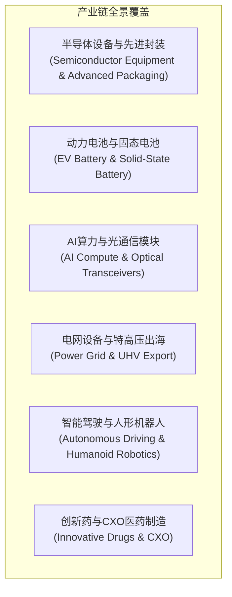

# ytrader 全景投研工作台重构方案 (Workbench Redesign Plan)

> **设计基准与目标承诺**：
> 彻底抛弃旧版“模拟文章/阅读器”（`EditorialReader`/`ContentReader`）以及本地访问密码墙，直面用户的核心真实需求：
> 1. **新闻事件 → 自动化关联对应产业链**：直观展示上中下游结构、运行逻辑、利润分配、关键壁垒、高频追踪指标，以及事件在产业链上的传导推演路径（0阶震中 → 1阶供需 → 2阶扩散）；
> 2. **产业链映射到具体 A 股个股**：提供独立、可追加、可删除、可启停的算法分析策略模块，拒绝黑箱打分；
> 3. **透明的数据源与 40 项核心指标底座**：明确呈现每项指标的计算公式、原始数据依赖、四层防未来函数时点（PIT）及东财/腾讯实时数据连接状态，为后续持续扩充算法打牢坚实根基。

---

## 目录
- [一、 痛点根因与根本重构原则](#一-痛点根因与根本重构原则)
- [二、 零摩擦极速进入架构 (Zero-Friction Dev Entry)](#二-零摩擦极速进入架构-zero-friction-dev-entry)
- [三、 实时 A 股快讯与六大核心产业链传导引擎](#三-实时-a-股快讯与六大核心产业链传导引擎)
- [四、 现代化全屏投研工作台 UI 架构 (`src/workbench/WorkbenchApp.tsx`)](#四-现代化全屏投研工作台-ui-架构-srcworkbenchworkbenchapptsx)
  - [View 1: 事件驱动 → 产业链结构、运行逻辑与传导全景](#view-1-事件驱动--产业链结构运行逻辑与传导全景)
  - [View 2: 个股可插拔算法策略分析模块](#view-2-个股可插拔算法策略分析模块)
  - [View 3: 数据源与 40 项数据指标中心](#view-3-数据源与-40-项数据指标中心)
- [五、 后端 API 规范与数据连接器架构](#五-后端-api-规范与数据连接器架构)
- [六、 实施步骤与交付路线图](#六-实施步骤与交付路线图)

---

## 一、 痛点根因与根本重构原则

### 1.1 为什么旧版被用户判定为“完全不能用，失败的产品”？
1. **本地开发密码墙反人性**：在本地 `http://127.0.0.1:5173/` 环境下，每次打开页面都会跳出“访问密码 / 登录阅读”阻断界面，极大破坏快速调试和使用体验。
2. **“文摘阅读器”误置了产品形态**：原系统设计参照了静态资讯阅读器（`EditorialReader`），通过文摘、引用脚注、文章流展示，用户根本无法在此展开结构化的投研推演。
3. **缺乏实时行情与新闻抓取**：只能依赖静态 Mock 事件或落后数据，无法实时同步东财/新浪 7x24 A股快讯，也无法让用户随手粘贴一段新闻直接推演产业链。
4. **指标与数据源黑盒化**：用户无法直观查验系统计算策略到底用了哪些指标、数据从哪里来、是否包含未来函数。

### 1.2 根本重构五大原则
| 原则 | 具体实现方式 |
| --- | --- |
| **1. 零密码无感直达** | 本地开发环境支持一键自动发放 Session，打开浏览器直接进入主工作台，彻底移除登录墙遮挡。 |
| **2. 真实数据与自主输入** | 集成东财 7x24 实时快讯源，同时提供“自定义新闻/事件文本推演框”，支持粘贴任意资讯即时解析。 |
| **3. 六大核心产业链深度建模** | 半导体设备/固态电池/AI光通信/特高压/智能驾驶/创新药CXO，涵盖“结构图+利润池+传导路径+映射个股”。 |
| **4. 策略模块真正独立可插拔** | 策略可追加、可删除、可启停；非黑箱展示规则执行追踪（指标值 vs 阈值），拒绝笼统买卖推荐。 |
| **5. 40项数据指标全景透明化** | 专设“数据源与指标中心”，清晰展示 6 大类 40 项指标的实时取值、公式、数据源健康度与 PIT 时点。 |

---

## 二、 零摩擦极速进入架构 (Zero-Friction Dev Entry)

### 2.1 鉴权旁路与开发态自动登录机制
在本地开发或单人投研场景下，完全免除手动输入密码流程：

```mermaid
sequenceDiagram
    autonumber
    actor User as 用户 (浏览器)
    participant UI as Workbench 前端 (Vite:5173)
    participant Auth as server/auth.ts (preHandler)
    participant DevAPI as GET /api/v1/auth/dev-session
    participant DB as 本地 PostgreSQL (users / sessions)

    User->>UI: 打开 http://127.0.0.1:5173/
    UI->>Auth: GET /api/v1/auth/session (带已存 Cookie)
    alt 未认证 (401 UNAUTHENTICATED)
        UI->>DevAPI: GET /api/v1/auth/dev-session (开发免密接入)
        Note over Auth: preHandler 旁路跳过 /dev-session
        DevAPI->>DB: 查询/创建 dev_analyst 用户并签发 30 天开发会话
        DevAPI-->>UI: Set-Cookie: ytrader-dev=<token>; 返回 { authenticated: true, csrf_token }
        UI->>UI: 内存写入 csrf_token，状态置为 'authenticated'
    else 已认证 (200 OK)
        Auth-->>UI: 返回当前有效会话
    end
    UI-->>User: 0秒瞬间呈现投研工作台全景 (无任何密码弹窗)
```

### 2.2 后端落地细节
1. **`server/auth.ts`**:
   在 `app.addHook('preHandler')` 中，将免密路由加入白名单：
   ```ts
   if (
     request.method === 'OPTIONS' ||
     request.url.split('?')[0] === '/api/v1/auth/login' ||
     request.url.split('?')[0] === '/api/v1/auth/dev-session'
   ) return;
   ```
2. **`server/content/strategy-chain-api.ts`**:
   新增 `GET /api/v1/auth/dev-session` 路由：自动查询或插入 `users` 默认账户，生成并持久化 `sessions`，通过 `reply.setCookie` 植入 Cookie 并返回 CSRF Token。
3. **前端入口 `src/App.tsx` 改造**：
   挂载时执行 `session()`，捕获到未登录状态立即调用 `devSession()` 静默激活，直接渲染 `<WorkbenchApp />`。

---

## 三、 实时 A 股快讯与六大核心产业链传导引擎

### 3.1 真实 7x24 A股快讯抓取与自定义事件解析器 (`server/content/live-news.ts`)
支持双通道事件获取：
- **公共无鉴权快讯源**：
  - 东方财富 7x24 实时快讯：`https://newsapi.eastmoney.com/kuaixun/v1/getlist_102_ajaxResult_50_1_.html`
  - 新浪财经 7x24 直播流：`https://zhibo.sina.com.cn/api/zhibo/feed?page=1&page_size=20&zhibo_id=152`
- **用户自投事件输入**：
  - 支持在工作台输入框中直接粘贴任何新闻标题或研报段落，如：“*英伟达GB200全面采用液冷与高速铜缆连接*” 或 “*商务部对美韩进口多晶硅调整双反关税*”。
- **自然语言匹配与链条传导路由**：
  - 词法识别核心关键词、事件催化剂类型（产能扩张 / 政策变动 / 价格涨跌 / 技术突破 / 订单签署 / 地缘制裁）；
  - 判定影响直接作用的产业链环节（0阶震中）、一级传导环节（1阶上下游供需溢价）与二级扩散环节（2阶替代与竞争）。

### 3.2 深度建模的 6 大 A 股核心产业链全貌



#### 产业链 1：半导体设备与先进封装
- **上游（核心部件与设备）**：刻蚀机、薄膜沉积、清洗设备、高纯电子特气、大硅片、光刻胶。
  - *定价与运行逻辑*：国产化替代加速，半导体设备毛利率高达 45%-60%；研发投入与客户验证周期长（12-24个月）。
  - *标的映射*：北方华创 (`002371.SZ`)、中微公司 (`688012.SH`)、拓荆科技 (`688072.SH`)、沪硅产业 (`688126.SH`)。
- **中游（晶圆代工与先进封装）**：成熟/先进制程代工，Chiplet / 2.5D/3D / CoWoS 先进封装。
  - *定价与运行逻辑*：重资产折旧与稼动率敏感；摩尔定律逼近极限下先进封装成为提升算力主战场。
  - *标的映射*：中芯国际 (`688981.SH`)、华虹公司 (`688347.SH`)、长电科技 (`600584.SH`)、通富微电 (`002156.SZ`)。
- **下游（终端需求与算力整机）**：AI 算力加速卡、智能手机 SoC、汽车座舱与智驾芯片。
  - *标的映射*：寒武纪 (`688256.SH`)、海光信息 (`688041.SH`)。

#### 产业链 2：动力电池与固态电池
- **上游（锂资源与前驱体材料）**：锂辉石/盐湖提锂、三元正极、磷酸铁锂、负极、电解质（固态硫化物/氧化物）、涂覆隔膜。
  - *定价与运行逻辑*：强周期大宗期货价格传导，资源端毛利波动剧烈；固态电解质技术溢价极高。
  - *标的映射*：赣锋锂业 (`002460.SZ`)、当升科技 (`300073.SZ`)、璞泰来 (`603659.SH`)、恩捷股份 (`002812.SZ`)。
- **中游（动力与储能电芯 PACK）**：大圆柱、叠片电芯、半固态/全固态电池集成。
  - *定价与运行逻辑*：龙头“两头挤压”具备极强供应链议价权，极限制造良率构筑 20%-28% 毛利率护城河。
  - *标的映射*：宁德时代 (`300750.SZ`)、亿纬锂能 (`300014.SZ`)、国轩高科 (`002074.SZ`)。
- **下游（新能源汽车与储能应用）**：新能源乘用车整车、工商业储能、低空飞行器动力。
  - *标的映射*：比亚迪 (`002594.SZ`)、赛力斯 (`601127.SH`)、阳光电源 (`300274.SZ`)。

#### 产业链 3：AI 算力与光通信模块
- **上游（光电芯片与光学元件）**：InP/GaAs 200G EML 光芯片、硅光调制器、薄膜铌酸锂、DSP 电芯片、MT插芯。
  - *定价与运行逻辑*：海外寡头占据高端光电芯片 50% 以上毛利；技术代际升级极快（400G→800G→1.6T）。
  - *标的映射*：天孚通信 (`300394.SZ`)、源杰科技 (`688498.SH`)、光库科技 (`300620.SZ`)。
- **中游（高速光模块封装与集成）**：800G/1.6T 光模块、LPO / CPO 光电共封装方案。
  - *定价与运行逻辑*：深度绑定北美及国内云巨头，享有高端新品前 1-2 年高毛利红利（30%-38%）。
  - *标的映射*：中际旭创 (`300308.SZ`)、新易盛 (`300502.SZ`)。
- **下游（AI 智算集群与云数据中心）**：超大规模 AI 训练集群、网络交换机、算力服务器集成商。
  - *标的映射*：工业富联 (`601138.SH`)、浪潮信息 (`000977.SZ`)、紫光股份 (`000938.SZ`)。

#### 产业链 4：电网设备与特高压出海
- **上游（取向硅钢与大宗原材料）**：高牌号低温高磁感取向硅钢、电解铜、高压绝缘套管与绝缘油。
  - *定价与运行逻辑*：取向硅钢技术寡头垄断，原材料成本占变压器 60% 以上。
  - *标的映射*：望变电气 (`603191.SH`)、江西铜业 (`600362.SH`)。
- **中游（变压器、GIS 与二次保护）**：特高压换流变压器、GIS 封闭组合电器、调度继电保护。
  - *定价与运行逻辑*：海外电网老化替换与新能源并网共振，变压器出海交付周期拉长至 2-3 年，出海毛利突破 35%。
  - *标的映射*：国电南瑞 (`600406.SH`)、中国西电 (`601179.SH`)、特变电工 (`600089.SH`)、思源电气 (`002028.SZ`)。
- **下游（主干电网与海外电力公用事业）**：国家电网/南方电网特高压工程、欧美新能源升压站。

#### 产业链 5：智能驾驶与人形机器人
- **上游（核心传感器与高精密执行机构）**：六维力矩传感器、谐波/行星减速器、空心杯电机、车规激光雷达。
  - *定价与运行逻辑*：机器人灵巧手与关节核心零部件加工精度公差达到微米级，毛利高达 40%-55%。
  - *标的映射*：绿的谐波 (`688017.SH`)、鸣志电器 (`603728.SH`)、柯力传感 (`603662.SH`)。
- **中游（域控制器与总成集成）**：智驾计算平台域控、人形机器人旋转/线性执行器总成。
  - *定价与运行逻辑*：Tier 1 汽车零部件企业向机器人赛道外溢，依托规模化极限降本能力。
  - *标的映射*：三花智控 (`002050.SZ`)、拓普集团 (`601689.SH`)、德赛西威 (`002920.SZ`)。
- **下游（高阶智驾整车与具身智能终端）**：具备高阶城市 NOA 的新能源车、工业制造与商用服务机器人。
  - *标的映射*：赛力斯 (`601127.SH`)、小鹏汽车/理想产业链。

#### 产业链 6：创新药与 CXO 医药制造
- **上游（生命科学原料与分离填料）**：高纯原料药、色谱填料、重组蛋白试剂、实验模型动物。
  - *标的映射*：纳微科技 (`688690.SH`)、药石科技 (`300725.SZ`)、百普赛斯 (`301080.SZ`)。
- **中游（临床前/临床 CRO 与 CDMO 生产）**：药物分子发现、安评、化学合成定制与生物药大分子代工。
  - *定价与运行逻辑*：全球新药研发管线开支与投融资景气度主导；地缘政策风险与海外产能布局是胜负手。
  - *标的映射*：药明康德 (`603259.SH`)、凯莱英 (`002821.SZ`)、康龙化成 (`300759.SZ`)。
- **下游（自主研发创新药与商业化放量）**：PD-1/ADC/GLP-1 重磅靶点新药，国内医保谈判与海外 License-out。
  - *标的映射*：恒瑞医药 (`600276.SH`)、百济神州 (`688235.SH`)。

### 3.3 传导推演模型规范 (Transmission Graph)
每个事件命中产业链后，算法引擎自动生成结构化推演：
```json
{
  "event_id": "live-em-20261016-01",
  "headline": "多家头部云厂商追加1.6T光模块采购需求，AI超算中心网络带宽扩容",
  "matched_chain": "AI算力与光通信模块",
  "epicenter_stage": "midstream",
  "transmission_steps": [
    {
      "step": 0,
      "stage": "midstream",
      "stage_name": "中游 · 800G/1.6T光模块研发与封装",
      "direction": "positive",
      "mechanism": "下游大厂直接下达1.6T追加采购订单，量价齐升，在手订单饱满度提升",
      "lead_lag": "即时到 1 个季度业绩确认",
      "conditions": "北美及国内云厂商资本开支指引不出现下修"
    },
    {
      "step": 1,
      "stage": "upstream",
      "stage_name": "上游 · 200G EML光芯片与光学元件",
      "direction": "positive",
      "mechanism": "中游排产拉满倒逼上游高频发射芯片与光学组件补库，上游核心零部件供应偏紧产生涨价预期",
      "lead_lag": "滞后 1-2 个月采购传导",
      "conditions": "上游晶圆厂产能交付周期未出现瓶颈中断"
    },
    {
      "step": 2,
      "stage": "downstream",
      "stage_name": "下游 · AI智算集群运营与交换机设备",
      "direction": "mixed",
      "mechanism": "算力互联网络吞吐带宽瓶颈得到缓解，但初期网络硬件建置 Capex 成本增加",
      "lead_lag": "滞后 3-6 个月集群点亮",
      "conditions": "大模型商业化推理变现速度能覆盖网络基础设施折旧"
    }
  ],
  "invalidation_signals": [
    "若云厂商单季资本开支增速环比转负",
    "若CPO共封装技术突破过快导致插拔式光模块预期生命周期被压缩"
  ]
}
```

---

## 四、 现代化全屏投研工作台 UI 架构 (`src/workbench/WorkbenchApp.tsx`)

取代原有的 `EditorialReader`，打造**全屏高密度专业 A 股投研工作台**。

```
┌────────────────────────────────────────────────────────────────────────────────────────────────────┐
│ 🚀 ytrader 机构级产业链与个股策略投研终端               [实时行情连接: 正常] [PIT时点: 严格审计]   │
│ ┌───────────────────────────────────────┬──────────────────────────┬─────────────────────────────┐ │
│ │ ⚡ View 1: 事件驱动与产业链传导全景     │ 🎯 View 2: 个股算法策略分析│ 📊 View 3: 数据源与40项指标中心 │ │
│ └───────────────────────────────────────┴──────────────────────────┴─────────────────────────────┘ │
├────────────────────────────────────────────────────────────────────────────────────────────────────┤
│ (当前激活 View 呈现区：支持 3 标签快速切换，左侧联动下钻，任意点击个股代码即刻切入 View 2 深度剖析) │
└────────────────────────────────────────────────────────────────────────────────────────────────────┘
```

### View 1: 事件驱动 → 产业链结构、运行逻辑与传导全景
- **左侧侧边栏 (350px 固定)**：
  - **实时 7x24 A股快讯流**：一键“同步最新A股快讯”按钮，带时间戳、重要性评级与链条分类标签。
  - **自定义事件输入推演框**：支持用户随意粘贴新闻、公告或会议纪要，点击“即刻推演”直接输出链条传导。
  - **六大产业链快速切换 Pill**：快速切换查看不同产业链的全景底座。
- **右侧主工作区**：
  - **A. 产业链运行逻辑与价值分布卡片**：
    - 呈现核心利润池分布（哪一环节吃掉最大利润）、上下游议价权机制、当前周期驱动力、产能供需缺口、高频追踪指标（如碳酸锂期货价、硅片开工率、光模块交期）。
  - **B. 事件传导推演路径图**：
    - 阶梯式呈现：`0阶震中` → `1阶直接传导` → `2阶扩散推演`，清晰展示正面催化/负面承压/结构分化徽标、传导机制解释、成立条件与**证伪反向信号**。
  - **C. 上游 → 中游 → 下游 3段式交互拓扑图**：
    - 卡片化展示各环节毛利区间、竞争壁垒、技术路线；
    - 展开列出**具体对应 A 股上市公司**（股票代码、名称、在产业链中的具体角色、事件直接影响）。
    - **双击/点击任何股票代码直接联动打开 View 2 进行该个股算法策略全项诊断**。

### View 2: 个股可插拔算法策略分析模块
- **顶部个股检索栏**：
  - 支持快捷选择热门标的（中际旭创、北方华创、宁德时代、中芯国际、赛力斯、恒瑞医药等），或在输入框中输入任意 6 位 A 股代码（自动补全 `.SZ`/`.SH`/`.BJ`）。
  - **实时行情看板**：现价、涨跌幅、当日成交额、最新总市值、PE-TTM、PB-MRQ、所属产业链定位。
- **第一层：五层基本面非黑箱总结 (Five-Layer Breakdown)**：
  - `估值层` (便宜/合理/偏贵/壳风险)
  - `质量层` (高质量/稳健/低质)
  - `现金与财务红旗层` (安全/关注/高危预警)
  - `市场防御层` (低波防御/中性/高波投机)
  - `产业链传导层` (强催化受益/中性/承压受损)
  - **核心反向证据提示**（如“虽然表面估值低，但近两季应计比率异常飙升，警惕纸面富贵”）。
- **第二层：独立策略插件列表（可插拔执行跟踪）**：
  - 逐条列出系统内置与用户自定义策略：
    1. A股盈利收益率价值策略 (`value_ep`)
    2. Piotroski F-Score + GP/A 质量策略 (`quality_fscore_gpa`)
    3. Sloan 应计质量与 A 股财务红旗预警 (`accrual_redflag`)
    4. 上证红利与综合股东收益率策略 (`dividend_shareholder`)
    5. 低波与全天候市场防御策略 (`low_vol_defense`)
    6. 产业链传导共振策略 (`chain_diffusion`)
    7. 用户自定义策略列表 (`custom_*`)
  - **规则逐项透明审计明细**：展开显示策略内的每一条规则判断（例如：`ep_ttm: 8.42% > 6.00% [通过]`、`sloan_accrual: -0.03 < 0.10 [通过]`、`is_st_risk: 否 [通过]`）。
- **第三层：策略插件管理抽屉 (Strategy Builder & Plugin Manager)**：
  - 用户可点击“+ 新建独立算法策略”：
    - 输入策略名称、学术/实战依据、分类；
    - 自由添加多个指标判断条件（指标Key、比较符 `>` / `>=` / `<` / `<=` / `==`、阈值）；
    - 设定红旗一票否决规则；
    - 设定利好/警示判定文字；
  - 策略列表提供**一键启停开关 (Toggle Switch)** 与**删除按钮**（内置策略保护不被物理删除，但可自由停用）。

### View 3: 数据源与 40 项数据指标中心
满足用户明确强调的“*主要是看看需要那些数据指标，把数据源做好，后面应该就方便了*”：
- **顶部数据源健康监测看板**：
  - `东财 F10 财务报表连接器 (zyzbAjaxNew)`：在线，延迟 < 300ms
  - `东财分红与股本结构连接器 (BonusFinancing & CapitalStock)`：在线
  - `腾讯高频行情与前复权日 K 线 (fqkline / qt)`：在线，行情更新至最新交易日
  - `Point-in-Time 时点审计防未来函数引擎`：严格生效中（区分 4 层时间戳）
- **指标状态大盘卡片**：
  - 40 项指标总数、就绪数（OK）、可用但陈旧数（Stale）、未知待补充数（Unknown）。
  - 提供“⚡ 强制全量实时刷新”按钮，直接穿透缓存拉取最新数据。
- **40 项数据指标权威全景字典与实时穿透表**：
  以表格化与卡片化呈现全部 40 项指标，支持按 6 大类筛选与关键词搜索：

| 类别 | 序号 | 字段 Key | 中文名称 | 计算公式与定义 | 依赖原始字段 | 消费该指标的策略插件 | PIT 时点类型 |
| --- | --- | --- | --- | --- | --- | --- | --- |
| **估值与壳修正** | 1 | `total_mv` | 总市值 | 当日收盘价 × 总股本 | 腾讯 `qt[45]`/`f116` | 价值策略/壳修正 | 市场交易日 |
| | 2 | `ep_ttm` | 盈利收益率 | 归母净利润(TTM) / 总市值 | `PARENTNETPROFIT` / `total_mv` | 价值策略/质量策略 | 报告期+交易日 |
| | 3 | `ep_deduct_ttm` | 扣非盈利收益率 | 扣非归母净利润(TTM) / 总市值 | `KCFJCXSYJLR` / `total_mv` | 价值策略 | 报告期+交易日 |
| | 4 | `bp_mrq` | 账面市值比 | 归母净资产 / 总市值 | `JZC` / `total_mv` | 价值策略 | 报告期+交易日 |
| | 5 | `is_st_risk` | ST/*ST 警示 | 股票简称是否含 ST/*ST/退 | 股票简称 `name` | 全策略一票否决 | 交易日状态 |
| | 6 | `shell_size_flag`| 小微盘壳污染 | 市值 ≤ 35 亿元 (A股后30%) | `total_mv` | 价值与质量策略 | 市场交易日 |
| **盈利质量成长** | 7 | `roe_jq` | 加权净资产收益率 | 净利润 / 加权净资产 | 东财 `ROEJQ` | 质量策略 | 财务报告期 |
| | 8 | `roa_net` | 总资产净利率 | 净利润 / 资产总计 | 东财 `ZZCJLL` | 质量策略/F-Score | 财务报告期 |
| | 9 | `roic` | 投入资本回报率 | EBIT × (1-t) / 投入资本 | 东财 `ROIC` | 质量策略 | 财务报告期 |
| | 10 | `gross_margin` | 销售毛利率 | 销售毛利润 / 营业总收入 | 东财 `XSMLL` | 质量策略/F-Score | 财务报告期 |
| | 11 | `gpa` | 毛利总资产比 | (营业收入 - 营业成本) / 总资产 | `XSMLL * REVE / TOTALASSETS` | Novy-Marx 质量策略 | 财务报告期 |
| | 12 | `rev_yoy` | 营业总收入增速 | (当期营收 - 同期营收) / 同期营收 | 东财 `TOTALOPERATEREVETZ` | 成长与质量策略 | 财务报告期 |
| | 13 | `np_parent_yoy` | 归母净利润增速 | (当期净利 - 同期净利) / 同期净利 | 东财 `PARENTNETPROFITTZ` | 成长与质量策略 | 财务报告期 |
| **F-Score 9项** | 14 | `fscore_roa_pos`| F1: ROA > 0 | 当期净利润为正 | `ROA > 0` | Piotroski 策略 | 财务报告期 |
| | 15 | `fscore_cfo_pos`| F2: CFO > 0 | 经营现金流净额为正 | `MGJYXJJE > 0` | Piotroski 策略 | 财务报告期 |
| | 16 | `fscore_delta_roa`| F3: ROA 提升 | 当期 ROA > 上年同期 ROA | `ROA(t) > ROA(t-1)` | Piotroski 策略 | 财务报告期 |
| | 17 | `fscore_cfo_gt_np`| F4: 现金优于利润 | 经营现金流 > 净利润 | `CFO > NetProfit` | Piotroski 策略/红旗 | 财务报告期 |
| | 18 | `fscore_delta_lever`| F5: 杠杆未恶化 | 长期负债率未同比增加 | `DebtRatio(t) <= DebtRatio(t-1)`| Piotroski 策略 | 财务报告期 |
| | 19 | `fscore_delta_curr`| F6: 流动比改善 | 当期流动比率高于同期 | `Current(t) > Current(t-1)` | Piotroski 策略 | 财务报告期 |
| | 20 | `fscore_no_eq_iss`| F7: 无股权稀释 | 近一年未增发或配股新股 | 东财 `BonusFinancing` | Piotroski 策略/股东 | 公告生效日 |
| | 21 | `fscore_delta_gm`| F8: 毛利率改善 | 当期销售毛利率高于同期 | `GM(t) > GM(t-1)` | Piotroski 策略 | 财务报告期 |
| | 22 | `fscore_delta_turn`| F9: 资产周转提升 | 总资产周转率高于同期 | `Turnover(t) > Turnover(t-1)` | Piotroski 策略 | 财务报告期 |
| | 23 | `fscore_total` | F-Score 总得分 | 9 项财务改善信号求和 (0~9) | ∑(F1..F9) | Piotroski 质量策略 | 财务报告期 |
| **现金流与红旗** | 24 | `cfo_to_np` | 净现比 (CFO/NP) | 经营现金流净额 / 净利润 | `MGJYXJJE / (PARENTNETPROFIT/Shares)` | 财务红旗策略 | 财务报告期 |
| | 25 | `sloan_accrual` | Sloan 应计比率 | (净利润 - 经营现金流) / 总资产 | `(NP - CFO) / TotalAssets` | Sloan 应计策略 | 财务报告期 |
| | 26 | `debt_ratio` | 资产负债率 | 负债总额 / 资产总计 | 东财 `ZCFZL` | 财务风险策略 | 财务报告期 |
| | 27 | `current_ratio` | 流动比率 | 流动资产 / 流动负债 | 东财 `LD` | 财务风险策略 | 财务报告期 |
| | 28 | `ar_turnover_days`| 应收账款周转天数 | 360 / 应收账款周转率 | 东财 `YSZKZZTS` | 营运质量/红旗预警 | 财务报告期 |
| | 29 | `inv_turnover_days`| 存货周转天数 | 360 / 存货周转率 | 东财 `CHZZTS` | 营运质量/红旗预警 | 财务报告期 |
| **股东回报分红** | 30 | `dividend_yield_ttm`| 股息率 (TTM) | 近12个月分红金额 / 总市值 | `TOTAL_DIVIDEND / total_mv` | 红利策略 | 公告日+交易日 |
| | 31 | `dividend_streak_years`| 连续分红年数 | 历史连续实施现金分红年数 | 东财 `lnfhrz` 分红序列 | 红利策略 | 历史公告序列 |
| | 32 | `payout_ratio` | 股利支付率 | 现金分红总额 / 归母净利润 | `Dividends / NetProfit` | 红利策略 | 财务报告期 |
| | 33 | `shareholder_yield`| 综合股东收益率 | 股息率 + 回购率 - 净融资稀释率 | `DivYield + Buyback - Issuance`| 综合股东回报策略 | 综合 PIT |
| **市场风险动量** | 34 | `vol_252d` | 年化波动率 (252日) | 日收益率样本标准差 × √252 | 腾讯前复权日 K 线 | 低波防御策略 | 市场交易日 |
| | 35 | `downside_vol_252d`| 下行波动率 (252日) | 负收益日标准差 × √252 | 腾讯前复权日 K 线 | 排序与下行防御 | 市场交易日 |
| | 36 | `beta_252d` | 沪深300相对Beta | 标的与沪深300协方差/方差 | 腾讯日 K 线 + 沪深300 K线 | 市场风险策略 | 市场交易日 |
| | 37 | `max_drawdown_252d`| 近1年最大回撤 | 252日内最高价至后续最低价回撤 | 腾讯前复权日 K 线 | 尾部风险预警 | 市场交易日 |
| | 38 | `adv_20d` | 20日日均成交额 | 过去20个交易日成交金额均值 | 腾讯日 K 线 `amount` | 流动性过滤 | 市场交易日 |
| | 39 | `ret_12m_skip_1m`| 动量 (12-1M) | 过去12个月累计收益剔除最近1个月 | `(P_t-20 / P_t-250) - 1` | 动量策略/趋势参考 | 市场交易日 |
| | 40 | `main_products_count`| 主营产品业务项数 | 公司披露的核心主营产品类别数 | 东财 F10 主营构成 | 产业链专注度过滤 | 报告期时点 |

---

## 五、 后端 API 规范与数据连接器架构

### 5.1 端点清单
```
// 1. 认证与开发接入
GET    /api/v1/auth/session                      // 检查当前有效会话
GET    /api/v1/auth/dev-session                  // 【新增】本地开发零摩擦免密激活
POST   /api/v1/auth/logout                       // 登出会话

// 2. 实时快讯与自定义事件推演
GET    /api/v1/content/news/live                 // 【新增】拉取东财/新浪实时 7x24 A股快讯列表
POST   /api/v1/content/events/analyze            // 【新增】用户自输入文本即时推演匹配产业链与传导路径

// 3. 产业链视图 (六大产业链 + 动态事件传导)
GET    /api/v1/content/chains                    // 【新增】列出 6 大深度建模核心产业链
GET    /api/v1/content/chains/:id                // 【新增】获取指定产业链详细拓扑结构、逻辑与个股
GET    /api/v1/content/events/:id/chain          // 获取指定事件推演的产业链传导路径
GET    /api/v1/content/industries/:id/chain      // 获取指定行业节点拓扑

// 4. 可插拔算法策略模块
GET    /api/v1/content/strategies                // 列出所有策略插件（含内置与自定义、启停状态）
POST   /api/v1/content/strategies                // 追加新的自定义分析策略
PUT    /api/v1/content/strategies/:id/toggle     // 启停指定策略插件
DELETE /api/v1/content/strategies/:id            // 删除自定义策略插件

// 5. 个股分析与数据指标
GET    /api/v1/content/companies/:code/strategies// 运行所有已启用策略对个股开展非黑箱评估
GET    /api/v1/content/companies/:code/indicators// 查询个股 40 项指标全量快照与 PIT 时点
POST   /api/v1/content/companies/:code/indicators/refresh // 强制穿透刷新指标与行情缓存
GET    /api/v1/content/datasources/status        // 【新增】数据源连接器在线状态与健康检查
```

### 5.2 实时快讯连接器实现 (`server/content/live-news.ts`)
```ts
export interface LiveNewsItem {
  id: string;
  source: 'eastmoney' | 'sina' | 'user_input';
  title: string;
  summary: string;
  publish_time: string;
  matched_chain_id?: string;
  matched_chain_name?: string;
  catalyst_direction?: 'positive' | 'negative' | 'mixed' | 'neutral';
  url?: string;
}
```
内部实现 `fetchLiveEastmoneyNews()`，对返回的每条快讯实时跑 `matchArchetype(newsText)`，快速将快讯关联至对应六大产业链并打标。

---

## 六、 实施步骤与交付路线图

### 第一阶段：免密接入与数据源实时引擎 (Phase 1)
1. **零摩擦免密会话**：修改 `server/auth.ts` 旁路放行 `/api/v1/auth/dev-session`，在 `server/content/strategy-chain-api.ts` 实现自动签发并注入 Cookie。
2. **实时新闻与六大产业链引擎**：
   - 新增 `server/content/live-news.ts` 实现东财/新浪实时抓取与快讯匹配；
   - 扩充 `server/content/chain.ts` 的 `CHAIN_ARCHETYPES` 至六大完整产业链（补充智能驾驶与人形机器人、创新药与CXO制造等完整上下游和个股池）；
   - 在 `strategy-chain-api.ts` 注册 `/news/live`、`/events/analyze`、`/chains` 与 `/datasources/status`。

### 第二阶段：现代化投研工作台 UI 重建 (Phase 2)
1. **替换旧版入口**：
   - 在 `src/App.tsx` 中移除旧的 `Login` 阻塞墙与 `EditorialReader`，改用自动免密接入；
   - 载入全新 `src/workbench/WorkbenchApp.tsx`。
2. **构建高密度全屏工作台框架**：
   - 顶部状态栏：实时连接状态、PIT 时点说明、View 1 / View 2 / View 3 标签切换器；
   - 响应式自适应暗色/亮色专业金融配色体系 (`src/workbench/workbench.css`)。

### 第三阶段：三大核心 View 完整交付 (Phase 3)
1. **View 1: 事件驱动与产业链传导**：
   - 左侧实时快讯流 + 自定义新闻文本输入推演器；
   - 右侧六大产业链拓扑卡片、利润池与核心壁垒分析、0阶/1阶/2阶事件传导图；
   - 节点直达个股联动。
2. **View 2: 个股可插拔算法策略分析模块**：
   - 6 位股票代码快速检索与实时行情展示；
   - 五层基本面非黑箱总结与核心反证；
   - 逐条规则审计追踪；
   - 策略追加、删除、启停管理抽屉。
3. **View 3: 数据源与 40 项数据指标中心**：
   - 连接器状态看板（东财 F10、分红股本、腾讯 K 线、PIT 引擎）；
   - 40 项指标全量透明字典（公式、依赖字段、消费策略、PIT 时点、当前股票实时值）；
   - 强制穿透刷新控制台。

### 第四阶段：端到端验证与持续保障 (Phase 4)
- 打开 `http://127.0.0.1:5173/` 验证 0 密码秒进；
- 点击“实时同步快讯”或粘贴任意新闻验证六大链条自动归类与传导推演；
- 搜索任意 A 股标的（如 `002371.SZ`, `300750.SZ`, `300308.SZ`）验证策略规则追踪与 40 项指标实时穿透；
- 测试新建自定义策略、启停与删除策略即时生效。
